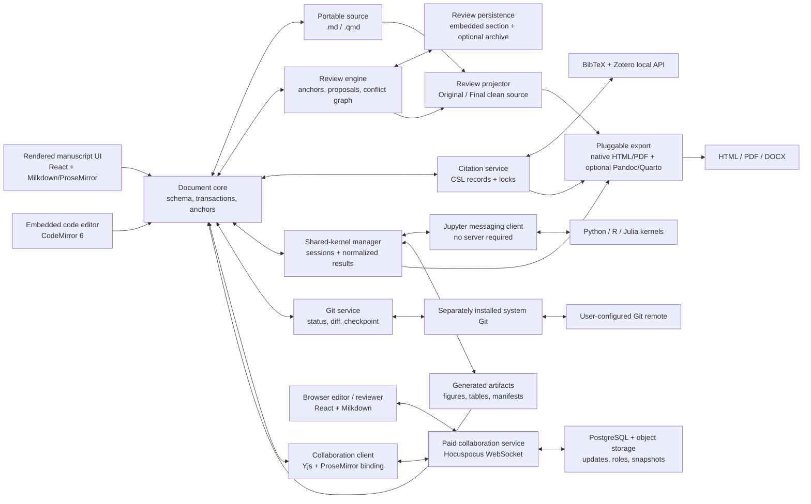

# DraftMatter: product and architecture brief

> Product and architecture record — created 2026-07-14; implementation status reconciled 2026-07-18
> Working name, not a cleared trademark.

## Executive decision

Build an **open-source, local-first desktop research writing environment** whose primary interface is a continuously rendered, editable manuscript. Authors should feel as though they are writing in a focused word processor, not editing Markdown source. Underneath, the project remains a portable folder of Markdown/Quarto files, bibliography data, code, generated assets, and review metadata.

The product combines six things that currently tend to live in separate tools:

1. a calm, rich manuscript editor;
2. citations from BibTeX and Zotero;
3. Word-like comments and tracked suggestions;
4. executable figures and tables from Python, R, and Julia;
5. explicit, researcher-friendly Git versioning;
6. paid online collaboration for coauthors and reviewers.

The recommended working name is **DraftMatter**: “draft” describes the authoring and review loop; “matter” evokes scientific subject matter, physical matter, and work that matters. A quick web screen found no obvious writing product with that exact name, but this is not domain or trademark clearance.

The working licence decision is **MIT for the desktop application, reusable document/review libraries, CLI/export tooling, and public collaboration code**. The initial delivery assumption was a macOS-first local MVP, with Git and local track changes in the open-source product and a paid managed collaboration service as a later milestone. Cloud execution and lossless Word round-tripping remain outside the planned scope.

As of 2026-07-18, the repository implements and certifies the local MVP in DM-P0 through DM-P5 and the repository-owned collaboration beta foundation in DM-P6. Windows, macOS, and Linux packaging paths are defined and tested in CI. The product is now in an **alpha refinement and real-manuscript dogfooding stage**, not an initial feature-spike stage. A public desktop release and operated paid service still depend on external signing, production infrastructure, security, privacy, support, and deployment gates that cannot be completed by repository code alone.

## Agent-executable implementation contract

This section is the canonical execution and status register for coding agents. The rest of this document supplies product behavior, architecture, constraints, and rationale. If a checklist item conflicts with a detailed requirement elsewhere, the detailed requirement wins and this register must be corrected in the same change.

### Goal

Deliver the **open-source local MVP** described in this brief. This goal is now repository-complete and certified: every DM-P0–P5 task and local acceptance criterion has evidence in [`docs/implementation-evidence.md`](docs/implementation-evidence.md). The original completion conditions were:

1. every task in phases DM-P0 through DM-P5 is checked;
2. every local acceptance criterion in this document is checked with evidence;
3. the full verification suite passes from a clean checkout;
4. a representative article-sized project can be opened, edited, reviewed, executed, checkpointed, exported, closed, and reopened without losing source, citations, outputs, or review state.

DM-P6 is a separate post-MVP goal for paid online collaboration. Its reusable editor, synchronization, authorization, persistence, and deterministic-checkpoint foundations are implemented and tested in the repository. This does not claim that a production service is deployed or externally security-reviewed. DM-P7 is the next active product milestone.

### Status and evidence rules

- `[ ]` means incomplete or not yet verified. Partially implemented work remains unchecked.
- `[x]` means implemented and verified. A checked task or acceptance criterion must have task-level evidence in [`docs/implementation-evidence.md`](docs/implementation-evidence.md); the completion log below records the certification batches and subsequent product refinements.
- Never mark a task complete from visual resemblance, a mocked interaction, or source inspection alone when the task requires persistence, execution, round-tripping, or integration behavior.
- Verification evidence must name the automated test, fixture, command, or reproducible manual scenario that proves the task. “Implemented” is not evidence.
- A task is complete only on every operating system claimed by that task. Platform-specific exceptions must remain unchecked or be split into explicit follow-up tasks.
- Preserve unrelated user changes. Prefer one coherent task or tightly coupled task group per commit, and include the task ID in the commit message.
- After completing a task, update its checkbox and append its test/fixture evidence and commit to the evidence ledger in the same commit; add a completion-log row when the task closes a gate or materially changes the product state.
- If implementation reveals that a task is underspecified, update this register before or together with the code; do not silently choose a materially different product behavior.
- Do not infer completion from an old checkbox. The evidence ledger and the current verification commands must still support the claim.

### Required verification commands

Run every command that applies to the current repository. Add missing test targets as the corresponding subsystem is introduced.

```text
npm run check
npm test
npm run build
cargo test --manifest-path src-tauri/Cargo.toml --locked
```

Before a release candidate, also run the repository's Playwright/end-to-end suite, golden Markdown round-trip suite, exporter fixtures, licence audit, and platform packaging checks. A task-specific check may be narrower during development, but its milestone gate requires the complete relevant suite.

### DM-P0 — Portable format and editor-risk spike

- [x] **DM-P0-01 — Representative fixture corpus.** Add at least 30 `.md`/`.qmd` fixtures covering YAML, headings, lists, citations, equations, footnotes, raw blocks, executable fences, output markers, comments, identical/nested/crossing review anchors, and unknown syntax. **Check:** fixtures are enumerated by an automated test and no fixture is silently skipped.
- [x] **DM-P0-02 — Deterministic parse/serialize round-trip.** Parse, serialize, reopen, and serialize every fixture without semantic loss or byte changes to preserved raw nodes. **Check:** a golden test compares repeated serialization and reports a focused diff.
- [x] **DM-P0-03 — Semantic prototype nodes.** Implement rendered citation, code-cell, output, review-anchor, and raw-Markdown nodes with stable IDs. **Check:** editor transaction tests create, edit, save, and reopen each node type.
- [x] **DM-P0-04 — Portable review records.** Parse and serialize versioned authors, proposals, threads, decisions, and point/range anchors in DraftMatter Review Markup. **Check:** identical, nested, and crossing proposals round-trip independently.
- [x] **DM-P0-05 — Original and Final projector.** Produce clean projections that remove every `.dm-anchor` and `.draftmatter-reviews` structure. **Check:** golden Original and resolved-Final outputs contain no reserved review markup; unresolved overlap fails closed with an actionable conflict list.
- [x] **DM-P0-06 — First rendered vertical slice.** Demonstrate one semantic citation, one mocked code result, one comment, one replacement, and two overlapping alternatives without exposing Markdown during normal use. **Check:** an end-to-end interaction test and visual snapshot cover the complete slice.
- [x] **DM-P0-GATE — Phase 0 exit gate.** All 30 fixtures pass deterministic round-trip and clean-projection tests; unsupported constructs are visibly preserved as raw nodes. **Depends:** DM-P0-01 through DM-P0-06.

### DM-P1 — Manuscript foundation

- [x] **DM-P1-01 — Cross-platform desktop shell.** Add the Tauri 2 host, typed privileged commands, and Windows/macOS/Linux development and packaging configuration. **Check:** the app starts without a generic shell-command bridge and platform builds are exercised in CI.
- [x] **DM-P1-02 — Local project lifecycle.** Open an existing project folder, create a project, discover `.md`/`.qmd` and bibliography files, persist project configuration, and reopen the last project safely. **Check:** integration tests use temporary project directories and never execute document code.
- [x] **DM-P1-03 — Rendered structured editing.** Support headings, paragraphs, lists, links, emphasis, quotations, equations, tables, images, captions, footnotes, citations, cross-references, code cells, and preserved raw blocks. **Check:** keyboard and transaction tests edit each supported node without revealing source punctuation in normal mode.
- [x] **DM-P1-04 — Deterministic autosave and recovery.** Implement debounced atomic save, undo/redo, crash recovery, and bounded recovery history. **Check:** fault-injection tests interrupt writes and prove that either the old or new valid document survives.
- [x] **DM-P1-05 — External file changes.** Detect edits, renames, and deletions made outside DraftMatter; reload safe changes and surface conflicts without overwriting either version. **Check:** file-watcher integration tests cover clean reload and dirty-buffer conflict paths.
- [x] **DM-P1-06 — Outline and source inspector.** Provide document navigation and a read-only/editable escape hatch for unsupported raw syntax. **Check:** outline navigation follows structural edits and raw bytes survive inspector round-trips.
- [x] **DM-P1-07 — Accessibility baseline.** Provide keyboard access, visible focus, semantic labels, reduced-motion behavior, and usable contrast for the editor and project lifecycle. **Check:** automated accessibility scan plus a documented keyboard-only smoke test.
- [x] **DM-P1-GATE — Phase 1 exit gate.** A researcher can create or open a short structured article, edit it without seeing Markdown, close it, and reopen identical portable source with recovery available. **Depends:** DM-P1-01 through DM-P1-07.

### DM-P2 — Citations and bibliography

- [x] **DM-P2-01 — Local bibliography ingestion.** Parse BibTeX, BibLaTeX-compatible records within the supported subset, CSL JSON, RIS/RefMan, and EndNote tagged text into normalized citation records with provenance. **Check:** fixtures cover braces, quoted fields, Unicode, multi-record RIS and EndNote payloads, missing fields, duplicate keys, and malformed input.
- [x] **DM-P2-02 — Zotero local integration.** Detect Zotero's local API, search records, retain Zotero item identity, and degrade cleanly when Zotero is closed or its API is disabled. **Check:** mocked API integration tests cover available, unavailable, and version-change paths.
- [x] **DM-P2-03 — Crossref scholarly search.** Search Crossref from the citation picker with debouncing, cancellation, structured author/year/title extraction, bibliographic-query fallback, local reranking, and rate-limit-safe caching. **Check:** mocked provider tests cover structured, ambiguous, empty, stale-response, offline, and HTTP 429 paths; the query `vezy et al. 2020 DynACof` ranks DOI `10.1016/j.envsoft.2019.104609` first.
- [x] **DM-P2-04 — Paste/drop citation intake.** Provide one visible paste/drop box accepting DOI text/URLs, BibTeX/BibLaTeX, CSL JSON, RIS/RefMan, EndNote tagged text, and supported files; sniff content, preview one or many records, report per-record errors, and never discard the original payload on failure. **Check:** keyboard paste and drag/drop tests cover each format, multiple records, duplicates, malformed input, oversized files, DOI resolution failure, and offline metadata imports.
- [x] **DM-P2-05 — Unified citation picker.** Search attached files, Zotero, and Crossref in grouped results; expose paste/drop and an explicit Google Scholar handoff; insert one or several works; and edit locators, prefix/suffix text, and author suppression. **Check:** end-to-end tests complete local, Zotero, Crossref, and Scholar-export/paste flows entirely by keyboard except for the external Scholar interaction.
- [x] **DM-P2-06 — Portable acquisition transaction.** On acceptance—never merely on result display—resolve DOI metadata to CSL JSON when available, assign a stable collision-safe citekey, retain provider identity, materialize a deterministic record in the configured project bibliography, and update the citation lock/cache atomically. **Check:** failure injection proves that bibliography, lock, and manuscript either all advance to one valid state or remain unchanged; repeated acquisition is idempotent by DOI/provider identity.
- [x] **DM-P2-07 — Live CSL rendering.** Render in-text citations and bibliography with the configured style and locale. **Check:** golden outputs cover representative author counts, disambiguation, locators, and locales.
- [x] **DM-P2-08 — Citation lock, cache, and diagnostics.** Persist citekey-to-source mappings and cited CSL snapshots; report missing, duplicate, aliased, renamed, or unavailable records without merging automatically; and reopen cited works when Zotero or remote providers are unavailable. **Check:** rename, duplicate, offline-Crossref, and offline-Zotero fixtures retain the same readable citation and bibliography entry with actionable diagnostics.
- [x] **DM-P2-GATE — Phase 2 exit gate.** Find and cite the DynACof paper from Crossref, cite another record pasted or dropped in every supported interchange family, insert and edit a Zotero citation, close Zotero and disconnect the network, reopen the app, and export the same configured bibliography style. **Depends:** DM-P2-01 through DM-P2-08.

### DM-P3 — Execution, figures, and tables

- [x] **DM-P3-01 — AST-based executable-cell extraction.** Extract executable fences and attributes without matching fences inside review payloads, raw regions, or literal examples. **Check:** adversarial Markdown fixtures prove correct extraction and stable cell IDs.
- [x] **DM-P3-02 — Runtime and kernel integration.** Discover Python, R, and Julia environments and Jupyter kernels independently, record health, never install or run anything on project open, and offer an explicit trust-gated setup/repair action for `ipykernel`, `IRkernel`, or `IJulia`. **Check:** mocked discovery covers every combination of present runtime, missing runtime, missing integration, failed startup, and healthy kernel.
- [x] **DM-P3-03 — Shared-kernel result contract.** Implement one normalized Jupyter result contract containing streams, errors, rich MIME metadata, artifacts, hashes, environment fingerprints, session generation, and execution sequence. **Check:** protocol and integration tests prove that same-language cells share state while different languages remain isolated.
- [x] **DM-P3-04 — Execution lifecycle and console.** Implement explicit run, run above, language run-all, interrupt, restart, terminate, fresh clean-run, setup-first execution, and the bottom console over the same kernels. **Check:** integration tests verify ordering, cancellation, restart invalidation, interactive dirty state, console-to-setup promotion, kernel isolation by language, and no implicit execution.
- [x] **DM-P3-05 — Output rendering and isolation.** Render supported image, HTML, Markdown, text, table, and error outputs; sanitize or isolate HTML from privileged APIs. **Check:** MIME fixtures include malicious HTML and prove it cannot access the desktop bridge.
- [x] **DM-P3-06 — Artifact materialization.** Write ordinary figure/table artifacts and idempotent output blocks without modifying author text outside reserved markers. **Check:** repeated materialization is byte-stable and missing declared artifacts fail clearly.
- [x] **DM-P3-07 — Freshness and provenance.** Track current, stale, running, failed, interrupted, and environment-changed states using code, input, environment, and artifact hashes. **Check:** edits invalidate the correct same-language suffix and clean run-all restores certification.
- [x] **DM-P3-08 — Missing runtime with retained output.** Keep existing images, tables, values, and MIME results visible when their runtime is absent; show quiet provenance, disable only execution, and distinguish current/stale from unavailable/missing output. **Check:** fixtures cover current+unavailable, stale+unavailable, missing-output+unavailable, and independent language availability.
- [x] **DM-P3-09 — Trust boundary.** Require explicit project trust before first execution and expose only typed execution commands to the UI. **Check:** opening an untrusted project cannot start a process, and browser collaborators have no execution capability.
- [x] **DM-P3-GATE — Phase 3 exit gate.** A clean restart reproduces at least one figure and table across Python, R, and Julia through selected shared Jupyter kernels; retained outputs remain readable when those runtimes are subsequently unavailable. **Depends:** DM-P3-01 through DM-P3-09.

### DM-P4 — Comments and tracked suggestions

- [x] **DM-P4-01 — Comment threads.** Create range/point comments, replies, resolve/reopen/delete actions, attribution, and aligned review balloons. **Check:** persistence tests survive restart and moderate external edits.
- [x] **DM-P4-02 — Suggestion capture.** Convert grouped insertion, deletion, and replacement transactions into attributed proposal records without changing accepted base text. **Check:** typing, paste, delete, and replace scenarios create one deterministic proposal each.
- [x] **DM-P4-03 — Conflict graph.** Derive identical, nested, crossing, and alternative-range conflicts without storing a second source of truth. **Check:** interval fixtures enumerate the expected conflict components.
- [x] **DM-P4-04 — Atomic decisions.** Accept, reject, and rebase proposals exactly once; preserve intersecting work as Needs rebase or an explicit decision conflict. **Check:** concurrent and repeated-decision tests never silently discard or double-apply content.
- [x] **DM-P4-05 — Markup views and navigation.** Implement Simple Markup, All Markup, Original, Final, author filters, and next/previous change navigation. **Check:** visual and interaction tests verify the same underlying proposal set in every view.
- [x] **DM-P4-06 — Re-anchoring and unplaced queue.** Recover anchors using positions plus quote context and surface ambiguous/orphaned reviews for manual placement. **Check:** external-edit fixtures cover successful, ambiguous, and failed recovery.
- [x] **DM-P4-07 — Review export.** Generate Original, resolved Final, and a separate review report without leaking review structures into publication outputs. **Check:** golden exports assert the absence of every reserved `.dm-*` structure.
- [x] **DM-P4-GATE — Phase 4 exit gate.** Two authors' identical and crossing proposals survive restart and external edits; accepting one changes the base once and retains affected alternatives as Needs rebase. **Depends:** DM-P4-01 through DM-P4-07.

### DM-P5 — Export, Git, and release hardening

- [x] **DM-P5-01 — Native HTML export.** Render the clean semantic projection with citations, equations, cross-references, figures, tables, and safe styling. **Check:** golden HTML fixtures pass structural and visual comparison.
- [x] **DM-P5-02 — PDF and DOCX export.** Produce browser-printed PDF and clean DOCX with actionable diagnostics; do not claim Word tracked-change round-trip. **Check:** rendered page inspection and document-structure tests cover a representative article.
- [x] **DM-P5-03 — Optional Pandoc/Quarto adapters.** Detect separately installed tools and pass only clean projected source; neither tool executes DraftMatter cells. **Check:** adapter tests prove review data and executable side effects cannot leak into the external call.
- [x] **DM-P5-04 — Git status and semantic diff.** Detect repositories, show file status, and provide rendered prose/review diffs plus source diffs. **Check:** repository fixtures cover modified, added, deleted, renamed, binary, and conflicted files.
- [x] **DM-P5-05 — Explicit checkpoints.** Stage selected files and create named local commits without automatic commits or destructive history operations. **Check:** integration tests inspect the resulting tree and commit while preserving unrelated changes.
- [x] **DM-P5-06 — Guarded branches and remotes.** Create/switch branches safely and fetch, pull, or push only after explicit user actions; surface conflicts without discarding work. **Check:** local bare-remote fixtures cover success, divergence, authentication failure, and merge conflict.
- [x] **DM-P5-07 — Performance and resilience.** Keep a 50–100 page manuscript responsive, recover from crashes, and handle destructive edge cases without data loss. **Check:** recorded performance budgets, stress tests, and crash-recovery scenarios meet documented thresholds.
- [x] **DM-P5-08 — Release compliance.** Generate third-party notices and an SBOM, enforce the licence allowlist, package supported platforms, and document runtime diagnostics. **Check:** CI fails on unknown/disallowed licences and validates signed/notarized artifacts where applicable.
- [x] **DM-P5-GATE — Local MVP release gate.** Dogfood an article-sized project end to end, export clean HTML/PDF/DOCX/Markdown, reopen it intact, and create an explicit Git checkpoint. All local acceptance criteria are checked. **Depends:** DM-P5-01 through DM-P5-08 and every earlier phase gate.

### DM-P6 — Paid online collaboration beta

- [x] **DM-P6-01 — Browser-safe shared editor package.** Reuse the rendered editor/reviewer without filesystem, process, Git, or execution privileges. **Check:** capability tests prove privileged APIs are absent from browser builds.
- [x] **DM-P6-02 — Yjs synchronization.** Synchronize document structure, anchors, authors, proposals, threads, decisions, presence, and offline edits. **Check:** multi-client and reconnect tests converge deterministically without losing attribution.
- [x] **DM-P6-03 — Transactional review decisions.** Detect incompatible simultaneous accept/reject/rebase decisions using base revisions or state vectors. **Check:** offline concurrent-decision scenarios surface explicit conflicts rather than last-write-wins text.
- [x] **DM-P6-04 — Authenticated workspace service.** Implement roles, invitations, revocation, guest review, tenant isolation, rate limits, and activity audit. **Check:** authorization tests prove cross-tenant enumeration and access are impossible.
- [x] **DM-P6-05 — Durable and affordable operations.** Persist compact updates and snapshots, apply object-storage lifecycle policies, scale inactive infrastructure down, and verify backup/restore. **Check:** load/cost model, restore drill, retention/deletion test, and operational dashboards exist before charging users.
- [x] **DM-P6-06 — Deterministic local checkpoint.** Serialize live collaborative state into portable Markdown/review records and return it to the owner-controlled working tree without automatic Git actions. **Check:** two clients produce the same checkpoint bytes and the owner explicitly commits them.
- [x] **DM-P6-GATE — Collaboration beta gate.** Two editors create overlapping alternatives while one is offline, reconnect, explicitly resolve any decision conflict, retain attribution and threads, and create a deterministic owner-controlled checkpoint. Security, revocation, deletion, backup restoration, and monitoring checks pass. **Depends:** DM-P6-01 through DM-P6-06.

### DM-P7 — Alpha authoring polish and semantic-object workflow

DM-P7 converts the technically complete MVP into a smoother article-writing product. It deliberately prioritizes discoverability, friendly manuscript concepts, and real-project validation over another large subsystem.

- [x] **DM-P7-01 — Friendly object identities.** Generate readable, stable labels for figures, tables, equations, and sections without exposing cell UUIDs as the normal interface. Preserve existing portable labels and resolve generated-name collisions deterministically. **Check:** transaction and round-trip tests cover creation, rename, duplicate captions, reorder, reopen, and legacy machine labels.
- [x] **DM-P7-02 — Searchable cross-reference picker.** Replace manual target entry with a keyboard-accessible picker grouped by figures, tables, equations, and sections, showing current number and caption. **Check:** interaction tests insert and retarget every object kind without typing a source label.
- [x] **DM-P7-03 — Unified semantic-object inspector.** Edit caption, accessible description, portable label, and supported display options from one contextual inspector for manual and reproducible objects. Keep code provenance available but secondary. **Check:** edits round-trip through Markdown and retain identical HTML, PDF, and DOCX semantics.
- [x] **DM-P7-04 — Reference integrity and navigation.** Diagnose missing, duplicate, wrong-kind, and orphaned targets; update visible numbering after drag-and-drop; and navigate between a reference and its object. **Check:** reorder/delete/rename fixtures never leave a silently misleading reference.
- [x] **DM-P7-05 — Article-sized alpha dogfood.** Exercise project creation, structured authors, citations, Python/R/Julia figures and tables, published values, comments, suggestions, checkpoints, clean exports, close, and reopen on representative real manuscripts. Convert every discovered loss, blocked workflow, or recurring visual collision into a regression test. **Check:** a documented macOS/Windows/Linux dogfood matrix and stored representative projects pass without manual source repair.
- [ ] **DM-P7-GATE — Alpha authoring gate.** A researcher can build and revise an article with friendly semantic objects and cross-references without seeing machine identifiers, then export and reopen it with matching numbering, captions, references, outputs, and review state. **Depends:** DM-P7-01 through DM-P7-05.

### Global definition of done for a checked task

A task may be checked only when all applicable statements are true:

- behavior matches this brief and handles the named failure paths;
- automated tests fail before the implementation and pass afterward, or a documented reason explains why automation is not practical;
- type checking, unit/integration tests, and production build pass;
- user-visible behavior has been exercised in the rendered app, including keyboard and accessibility impact where relevant;
- persistence or projection changes include deterministic round-trip/golden coverage;
- privileged operations remain typed, narrow, explicit, and non-destructive;
- documentation and diagnostics are updated;
- the change is committed with its task ID and no unrelated user changes.

### Completion log

Task-by-task evidence is maintained in [`docs/implementation-evidence.md`](docs/implementation-evidence.md). This summary records phase certification and later product-level refinements. Do not remove old evidence; if a regression invalidates it, uncheck the affected item and add a row explaining why.

| Task ID | Evidence (tests, fixture, or reproducible scenario) | Commit | Verified on |
| --- | --- | --- | --- |
| DM-P0-GATE | Thirty-fixture deterministic round-trip suite and rendered vertical-slice end-to-end test. | `6fff187` | 2026-07-16 audit |
| DM-P1-GATE | Cross-platform Tauri lifecycle, structured editing, autosave/recovery, file-change, outline, and accessibility gates. | `f6dd589` | 2026-07-16 audit |
| DM-P2-GATE | Unified Crossref/Zotero/local/paste citation acquisition, offline reopen, and stable CSL output gate. | `2a308a3` | 2026-07-16 audit |
| DM-P3-GATE | Shared Jupyter kernels, clean restart, retained outputs, figures/tables, and published-value gate. | `17e11a0` | 2026-07-17 audit |
| DM-P4-GATE | Portable comments, tracked suggestions, overlap conflicts, decisions, re-anchoring, and clean review export gate. | `db90150` | 2026-07-16 audit |
| DM-P5-GATE | Native/optional exports, explicit Git workflows, resilience, compliance, CLI, and desktop release gate. | `22f33cb` | 2026-07-16 audit |
| DM-P6-GATE | Browser-safe collaboration, offline convergence, authorization, durable state, and deterministic checkpoint gate. | `2a7ed24` | 2026-07-16 audit |
| AC-L01–AC-L17 | Criterion-level tests and commits are enumerated in the implementation evidence ledger. | `22f33cb`, `17e11a0` | 2026-07-17 audit |
| AC-C01–AC-C06 | Criterion-level collaboration tests and commits are enumerated in the implementation evidence ledger. | `2a7ed24` | 2026-07-16 audit |
| DM-P7-01 | Friendly semantic identities, deterministic collisions, compatible legacy labels, and quiet UUID-free controls. | `6b489fd` | 2026-07-18 |
| DM-P7-02 | Searchable grouped cross-reference picker with keyboard insertion and retargeting. | `50f8f13` | 2026-07-18 |
| DM-P7-03 | Unified manual/reproducible object details, portable numbering, secondary provenance, and matching clean-export semantics. | `d3915b1` | 2026-07-18 |
| DM-P7-04 | Explicit missing/ambiguous/wrong-kind/orphan diagnostics, live renumbering, and bidirectional object-reference navigation. | `9634582` | 2026-07-18 |
| DM-P7-05 | Stored cross-language article fixture, exact lifecycle/export/checkpoint gate, rendered browser dogfood, and named four-target desktop CI matrix. | `3ebc0fa` | 2026-07-18 |
| UX refinement batch | White Graphite visual system, structured author profiles, section/block drag-and-drop, focused code/review surfaces, and contextual comment markers. | `b719d11`, `a22554e`, `5920675`, `d483fd9` | 2026-07-18 |
| Reproducible-output refinement batch | Child-folder project creation, shared-kernel console and published values, output-only export, CairoMakie image recovery, automatic numbering/captions, unified hover controls, and overlap repair. | `dc9e8d2`, `0c2c134`, `5f2b254`, `0d85304`, `15e4b63`, `597fc3c` | 2026-07-18 |

### Current interaction decisions

These decisions supersede earlier prototype behavior and capture the product direction established during hands-on app review:

- **Project creation chooses a parent location.** DraftMatter creates a new child directory from the project name; users are not expected to select an already empty final directory.
- **Authors are structured publication identities.** A name is only the minimum. Profiles support email, ORCID, and one or more affiliations, can be reused across projects, and remain distinct from review/collaboration identity where necessary.
- **Document structure is flexible.** Starter projects include conventional research sections, but authors can add sections and reorder sections or individual blocks with drag-and-drop. Rendered prose blocks remain editable unless the current collaboration role is intentionally read-only.
- **Rendered semantics own the ordinary writing experience.** Citations, links, equations, figures, tables, comments, suggestions, footnotes, and cross-references are edited through contextual controls. Typing after a semantic inline object resumes normal prose formatting instead of inheriting the object's presentation.
- **Review follows a familiar word-processor model.** Track changes is an explicit editing mode. Insertions and deletions remain interactive and attributed. Comments can be created contextually from selected text or nearby objects, and anchored text has a visible local marker as well as an aligned review rail.
- **Insertion commands must be operational, not decorative.** Sections, figures, tables, inline/display equations, code cells, footnotes, citations, cross-references, and published values insert structured portable nodes and reopen as the same objects.
- **Exports are user-directed and publication-clean.** Users choose the destination directory and filename. Native Markdown, HTML, PDF, and DOCX exclude review storage and executable source by default; code exists to reproduce figures, tables, and explicitly published in-text values, not to turn the manuscript into a visible notebook.
- **Computed manuscript values use explicit publication markup.** A values cell publishes named results, which prose inserts using portable `{{name}}` markup. Missing or stale values remain visible as diagnostics without exposing helper code in publication output.
- **Reproducible outputs are manuscript objects.** Retained CairoMakie and other supported rich outputs render as figures or tables rather than source HTML/base64 text. Figures, tables, and display equations number independently in document order; figures caption below, tables caption above, and display equations may carry an explanatory caption. `.unnumbered` remains available for exceptions.
- **Code and output read as one quiet object.** Source/run controls sit over the generated result, remain hidden until hover or keyboard focus on pointer-capable devices, stay available on touch layouts, and wrap without overlap in narrow manuscript columns. Full machine identifiers remain available to assistive technology and diagnostics but are not the primary visible interface.

## Product thesis

Researchers should be able to write a sentence, insert a formatted citation, run the code that produces the next figure, and respond to a coauthor’s proposed rewrite without changing applications or surrendering the manuscript to a proprietary file format.

The app is not “a Markdown editor with a preview pane.” It is a **living manuscript**:

- prose, equations, citations, figures, tables, and cross-references render in place;
- Markdown punctuation is hidden during ordinary writing;
- citations behave as semantic objects rather than fragile strings;
- executable cells behave as compact figure/table components rather than notebook clutter;
- suggestions appear as insertions, deletions, and margin balloons in the rendered document;
- the underlying project remains inspectable, versionable, and buildable without the app.

The simplest positioning is:

> **Word-like writing and review, Quarto-like reproducibility, Zotero-native citations.**

## Target user and primary job

The first user is an individual researcher or a small research team preparing an article, report, or thesis chapter. They are comfortable using Zotero and may know some Python, R, or Julia, but they should not need to understand Markdown syntax, kernels, or Pandoc to write.

Primary job:

> Produce a submission-ready manuscript whose claims, citations, figures, code, and review history remain connected and reproducible.

Secondary users are supervisors, coauthors, and reviewers who mainly want to read, comment, and propose changes. They should be able to use the app without seeing code or markup unless they deliberately expand it.

## Experience principles

### 1. Render first

The manuscript is always presented as styled prose. Selecting a citation, equation, figure, or code result reveals contextual controls. An optional source inspector exists for advanced users, but it is not a normal editing mode.

### 2. Semantic objects, not text tricks

A citation is a citation node with one or more source identifiers, locators, prefix/suffix text, and a rendered label. A figure is a figure node with code provenance, output, caption, label, and alt text. A suggestion is a typed document operation with identity, author, state, anchors, and proposed content; when saved, it has a portable DraftMatter Review Markup representation. Users normally see rendered review decorations, not the underlying anchor/data syntax.

### 3. Local and portable by default

The project is a normal directory. Bibliography files can be opened elsewhere, code remains ordinary code, and open review changes use a DraftMatter-native Markdown extension: zero-width boundary markers in the prose plus a hidden review-data section in the same file. A small open-source projector produces clean Original or resolved Final content before code extraction or any renderer starts. Optional sidecars may hold large attachments or archived history, and SQLite may be used as a disposable local index, but neither is the source of truth for an open proposal.

Online collaboration extends this local project; it does not replace it. A paid workspace synchronizes live editing state and comments, while explicit checkpoints materialize deterministic Markdown containing review anchors, proposals, authors, threads, and portable audit data that remain usable without the service.

### 4. Reproducibility is visible

Every executable result shows whether it is current, stale, running, failed, or produced in a different environment. The app never silently executes a manuscript when it opens.

### 5. Review should feel familiar

Use the interaction vocabulary researchers already know from Word:

- comment balloons in a right-hand rail;
- suggestion mode with attributed insertions and deletions;
- accept/reject one change or a selected set;
- threaded replies and resolved comments;
- **Simple Markup**, **All Markup**, **Original**, and **Final** views;
- next/previous change navigation.

### 6. Keep the managed service affordable

DraftMatter should keep recurring server costs low so the managed collaboration service can remain affordable. Prefer client-side computation, local caching, compact synchronization, object storage, and infrastructure that scales down when inactive. Server-side processing is appropriate when it materially improves security, reliability, collaboration, or user experience, but it should avoid unnecessary always-on compute, duplicate document processing, and excessive storage or bandwidth.

This is a cost-conscious constraint rather than a client-only rule. Authentication, authorization, durable synchronization, backups, notifications, billing, and other shared trust or coordination responsibilities remain server-side where required. New server-side document-processing capabilities should have an explicit operational or product justification when the same outcome could reasonably be produced on the user's device.

## Product scope

### Open-source product and paid service

The product should have two clearly separated capabilities:

| Capability | Open-source local product | Paid DraftMatter Cloud |
| --- | --- | --- |
| Writing, citations, local review, execution, export | Included under MIT | Included; browser participants focus on writing/review |
| Local comments and track changes | Included using DraftMatter Review Markup | Synchronized identities, threads, approvals, and review history |
| Local files and Git | Source of record | Checkpointed back to an owner-controlled working tree |
| Collaboration | Asynchronous through files/Git; self-hostable live server once released | Turnkey managed live co-editing, presence, comments, suggestions, roles, and share links |
| Code execution | Explicitly on the author’s machine | Disabled in the browser initially; remote execution is a separate future service |
| Account required | No locally; a self-hosted server manages its own users | Yes for the managed service, except optionally authenticated guest review links |
| Operations | User owns files and environments | Hosted sync, storage, backups, monitoring, email, billing, abuse prevention, and support |

This separation preserves a genuinely useful open-source product while giving paid customers an ongoing service: secure hosted coordination, browser access, presence, identity, managed history, and reliable operations. Do not rely on a client-side feature flag as the commercial moat; an MIT client can be rebuilt without it. The paid value must come from service operation, networked workflow, trust, and organizational capabilities.

Basic local track changes should **not** be paid-only. It is a defining local capability, makes the portable review format credible, and is difficult to gate meaningfully in an open-source client. The paid product is collaborative track changes: simultaneous reviewers, authenticated attribution, browser review links, notifications, permissions, approvals, audit retention, and recovery.

### Rich manuscript editing

- Continuously rendered paragraphs, headings, lists, links, emphasis, block quotes, equations, tables, images, captions, footnotes, citations, cross-references, and code cells.
- Slash menu and keyboard shortcuts for structured content.
- Outline/navigation sidebar.
- Contextual formatting toolbar; no persistent ribbon is required.
- Autosave, undo/redo, crash recovery, and external-file-change detection.
- Optional source inspector for unsupported or raw Markdown blocks.

### Citations and bibliography

- Attach one or more `.bib`, `.bibtex`, CSL JSON, `.ris`, or EndNote `.enw` files to a project.
- Search the connected Zotero desktop library through its local API.
- Search Crossref from the same picker for works not yet present locally; show local, Zotero, and online results in clearly labelled groups.
- Paste a DOI, DOI URL, BibTeX/BibLaTeX, CSL JSON, RIS/RefMan, or EndNote tagged export directly into the picker, or drop a supported citation file onto it.
- Open a prefilled Google Scholar search as an explicit browser handoff, then accept Scholar's BibTeX/EndNote export through the same paste/drop path or find an item saved by Zotero Connector.
- Insert a citation by typing `@` or using an **Insert citation** command.
- Select several works, add page/section locators, suppress the author, and add prefix/suffix text.
- Render citations and the bibliography in the selected CSL style in real time.
- Hover/click a citation to see title, authors, year, DOI/URL, attachment link, and Zotero link.
- Persist every accepted remote or pasted record into the portable project bibliography before writing its citekey into the manuscript; search previews remain transient.
- Cache cited records locally so the manuscript remains readable when Zotero is closed.
- Detect missing, duplicate, or renamed citation keys before export.

Crossref is the default remote search provider because its public REST API requires no account, supports bibliographic and structured field queries, and returns publisher-deposited metadata. When a selected result has a DOI, resolve the canonical record through `doi.org` content negotiation with `Accept: application/vnd.citationstyles.csl+json`; this also works across participating DOI registration agencies such as DataCite. OpenAlex is an optional secondary provider behind the same interface for broader discovery and citation relationships, but it must not be required for the local MVP or silently consume a paid quota. See the [Crossref REST API](https://www.crossref.org/documentation/retrieve-metadata/rest-api/), [Crossref DOI content negotiation](https://www.crossref.org/documentation/retrieve-metadata/content-negotiation/), and [OpenAlex API authentication and pricing](https://developers.openalex.org/api-reference/authentication).

Do not scrape Google Scholar or treat it as an API. Google explicitly provides interactive citation exports but not bulk programmatic access. DraftMatter should open Scholar in the user's browser with a prefilled query and make the return path nearly frictionless through paste/drop and Zotero Connector. When an authoritative publisher page is available, prefer its metadata over Scholar's extracted metadata. See [Google Scholar search help](https://scholar.google.com/intl/us/scholar/help.html), [Zotero Connector](https://www.zotero.org/support/connector), and [Zotero guidance for adding items](https://www.zotero.org/support/adding_items_to_zotero).

Zotero’s desktop client exposes API v3 on `localhost:23119`, with similar resources to the web API, which makes a local-first integration practical. Zotero 8 also introduced native citation keys; Better BibTeX remains a valuable optional adapter for established key-generation and auto-export workflows. See the [Zotero API documentation](https://www.zotero.org/support/dev/web_api/v3/basics), [Zotero 8 history](https://www.zotero.org/support/8.0_changelog), [Better BibTeX documentation](https://retorque.re/zotero-better-bibtex/), and [Better BibTeX automatic export](https://retorque.re/zotero-better-bibtex/preferences/automatic-export/).

### Word-like review

- Select rendered text and add a comment.
- Enable suggestion mode; typing, deleting, and pasting become attributed proposals. Formatting/structural changes are added only when they have a lossless portable representation.
- Display insertions inline with author color and underline; display deletions inline or in the margin with strikethrough.
- Keep comment and suggestion balloons aligned to the relevant line in a review rail.
- Accept or reject suggestions individually, by author, by selection, or all at once.
- Reply, resolve, reopen, and delete comment threads.
- Serialize point/range anchors as empty attributed spans directly in the Markdown/Quarto prose.
- Store proposals, authors, timestamps, states, threads, decisions, and fallback selectors in a hidden fenced review section in the same document.
- Permit several proposals against identical, nested, or crossing ranges without nesting markup wrappers.
- Always create a clean Original or Final projection before execution or rendering so review structures cannot leak into code or publication output.
- Warn when an external edit makes an anchor ambiguous, and provide an **Unplaced reviews** queue.

Overlapping proposals may coexist, but they are alternatives rather than an automatically composed final document. The review rail groups conflicts and lets an author compare, accept, reject, or request a rebase. Accepting one proposal transforms or marks intersecting open proposals as **Needs rebase**; it never silently rejects another author’s work.

[ChangeDown](https://github.com/hackerbara/changedown) and CriticMarkup remain useful prior art, but they are not the persistence format. CriticMarkup is span-oriented and ChangeDown explicitly treats overlapping/nested markup as a structural constraint; DraftMatter needs independent anchors plus alternative proposal records for multi-author real-time review.

### Git integration

Git should feel like manuscript history, not a developer console:

- detect an existing repository or initialize one with an appropriate `.gitignore`;
- show changed manuscripts, bibliography files, review logs, code, and generated artifacts in a status sidebar;
- offer both semantic rendered diffs for prose and ordinary source diffs for expert users;
- stage selected files or coherent groups, create a named checkpoint/commit, and browse or restore history;
- show the current branch and support guarded branch creation/switching when the working tree is safe;
- fetch, pull, and push only after explicit user actions, with conflicts surfaced rather than overwritten;
- never force-push, rewrite history, discard changes, or commit automatically;
- remain remote-agnostic in the MVP; GitHub/GitLab pull-request features can be later provider adapters.

The initial implementation should invoke the user’s separately installed system `git` through narrowly scoped Tauri host commands. This is operationally simple and keeps a GPL-licensed program outside the linked application. It is not a substitute for legal review: if Git is bundled later, the distribution must satisfy Git’s GPLv2 obligations. See [Git’s licensing statement](https://git-scm.com/about).

### Paid online collaboration

The paid workspace should provide:

- browser-based reading, writing, commenting, and suggestion mode with the same rendered-document interaction as desktop;
- real-time text and structural editing, live cursors, selections, presence, and reconnect/offline merge;
- owner, editor, commenter, and viewer roles at workspace/project level;
- invitation links, authenticated guests, revocation, and an auditable membership/activity log;
- live synchronization of citations, comments, suggestions, and document structure;
- immutable named checkpoints and recovery history in addition to transient live state;
- desktop ownership of code execution: browser collaborators may inspect code and outputs but cannot run project code in the first paid release.

Use **Yjs** as the shared CRDT layer and its ProseMirror binding for live document changes. Use a self-hosted **Hocuspocus** WebSocket collaboration service, PostgreSQL for accounts/projects/metadata, and object storage for project snapshots and generated artifacts. Yjs and Hocuspocus are MIT licensed, and PostgreSQL uses its permissive PostgreSQL License; see [Yjs](https://github.com/yjs/yjs), [Hocuspocus](https://github.com/ueberdosis/hocuspocus), and the [PostgreSQL licence](https://www.postgresql.org/about/licence/).

Keep this hosted path deliberately thin: editing, Markdown parsing and serialization, review projection, citation formatting, export preparation, CRDT merging, and offline caching should run in the client whenever practical. The service should focus on authenticated synchronization, authorization, durable updates and snapshots, workspace metadata, notifications, billing, backups, and operational safeguards. Optimize for compact incremental updates, lifecycle policies for inactive data, and infrastructure that can scale down; do not assume that short-lived serverless functions are cheaper than a small persistent service for long-lived WebSocket sessions.

The live CRDT and Git serve different purposes:

- Yjs is the low-latency shared editing state;
- the server persists Yjs updates and periodic immutable snapshots for recovery;
- an explicit checkpoint serializes deterministic `.qmd`/`.md` with review anchors, records, and audit history into the local working tree;
- Git records meaningful project milestones and integrates external code/data changes;
- the service never creates, pushes, rebases, or merges Git commits without an owner’s explicit action.

While a document is live, accepted content and anchor nodes live in the shared ProseMirror/Yjs document; proposals, authors, threads, and decisions live in Yjs maps keyed by stable IDs. At checkpoint time both serialize into the Markdown file’s inline anchors and hidden review section. Stable IDs, author IDs, base hashes, transactional decisions, and deterministic serialization are therefore requirements from the first local prototype.

### Executable figures and tables

- Insert an executable cell and choose Python, R, or Julia.
- Show code in a compact, syntax-highlighted editor that can collapse to a one-line provenance bar.
- Run cell, run cells above, run all cells of one language, interrupt, or restart a language session.
- Run every cell through the project’s selected shared Jupyter kernel; users choose languages and environments, never an execution implementation.
- Render images, SVG, HTML tables, Markdown, plain text, errors, and progress directly under the cell.
- Promote an output to a semantic figure or table with caption, label, alt text, and cross-reference.
- Save figures/tables as ordinary project artifacts and optionally materialize their references as normal Markdown or sanitized HTML.
- Show a stale badge when code, inputs, environment, or an earlier same-language cell has changed.
- Keep code visible to authors but allow a reading/review mode that shows only outputs and a small **View code** affordance.

Python, R, and Julia each use one long-lived Jupyter kernel per open project: `ipykernel`, `IRkernel`, and `IJulia`. DraftMatter starts and owns those processes through the Jupyter messaging protocol without JupyterLab, Jupyter Notebook, a notebook document, or a notebook server. See the [Jupyter messaging specification](https://jupyter-client.readthedocs.io/en/latest/messaging.html), [IRkernel](https://irkernel.github.io/installation/), and [IJulia](https://github.com/JuliaLang/IJulia.jl).

### Export

- HTML through DraftMatter’s own Markdown/semantic-document renderer for fast preview and sharing.
- PDF by printing the clean HTML projection with a headless browser and publication print CSS.
- DOCX through a dedicated adapter or optional Pandoc backend for journal/coauthor handoff.
- Optional Quarto/Pandoc export for users who want that ecosystem; neither is required to execute code or materialize figures/tables.
- Clean Markdown/Quarto projections remain available at all times even when the working document contains open review anchors and data.
- Export either accepted content, original content, or a “final preview” that applies open suggestions without accepting them.

Pandoc and Quarto support attributed spans and fenced divs, which makes them a practical compatibility substrate for DraftMatter Review Markup. The same DraftMatter projector also feeds the native HTML/PDF pipeline: it removes anchors and the hidden review section, resolves the selected proposal set, and emits a clean semantic document or Markdown projection. Optional Quarto/Pandoc export receives only that clean source and does not participate in code execution. See [Pandoc Divs and Spans](https://pandoc.org/MANUAL.html#divs-and-spans) and [Quarto Divs and Spans](https://quarto.org/docs/authoring/markdown-basics.html#divs-and-spans).

MVP DOCX export does **not** promise native Word tracked changes or comment round-trip. That is a later interoperability project. The first release exports clean content plus an optional separate review report.

## Deliberate non-goals for the local MVP

- Shipping the paid collaboration service inside the initial 16–20 week desktop milestone; its data model and integration seams are included from day one.
- Mobile authoring clients.
- Untrusted/cloud code sandboxing.
- Automatic package installation inside arbitrary research environments.
- Perfect dependency inference between code cells.
- Interactive Jupyter widgets.
- Full fidelity for every Pandoc, R Markdown, or Quarto extension.
- Lossless DOCX import/export with comments and tracked changes.
- Journal submission APIs or a reference-manager replacement.
- An AI writing assistant. The document/review model should permit one later, but AI is not required to prove the product.

## Core user journeys

### Start or open a paper

1. Create a project or open a folder containing `.md`/`.qmd` and bibliography files.
2. The app parses the manuscript into an interactive document and checks the citation and runtime configuration.
3. Unsupported syntax appears as a preserved raw block, never silently discarded.
4. The researcher writes in the rendered canvas; deterministic Markdown is saved in the background.

### Cite while writing

1. Type `@` in prose.
2. Search local bibliography and Zotero results immediately; after a short debounce, add grouped Crossref results without replacing or reordering the local groups unexpectedly.
3. If the work is not found, paste a DOI or exported citation, drop a citation file, or open a prefilled Google Scholar search and return through paste/drop or Zotero Connector.
4. Preview the normalized metadata, resolve any duplicate/citekey warning, select one or more records, optionally enter a page locator, and confirm.
5. DraftMatter atomically materializes newly acquired records in the configured project bibliography, updates the citation lock/cache, and inserts the citekeys.
6. The formatted citation appears immediately; its stable semantic data and acquisition provenance remain editable and inspectable.

### Build a figure

1. Insert a code cell and select a configured language environment.
2. Write or paste code and run it explicitly.
3. The output appears inline and receives **Current** status.
4. Add caption, label, and alt text; cross-reference it from prose.
5. A later upstream edit marks it **Stale** until rerun.

### Review a draft

1. Open the project in review mode; code is collapsed by default.
2. Highlight a sentence and add a comment, or enable suggestion mode and rewrite it.
3. The author switches among Simple Markup, All Markup, Original, and Final views.
4. Accepting a suggestion updates the semantic document and Markdown atomically; the decision remains in the embedded audit history.

### Create a Git checkpoint

1. Open the history sidebar and inspect a rendered summary of manuscript and review changes.
2. Select the files or change groups that belong together.
3. Name the checkpoint and commit it locally.
4. Push to a configured remote only when explicitly requested; any pull conflict opens a guided resolution view.

### Collaborate online

1. A paid customer publishes a local project to a private workspace and invites coauthors by role.
2. Coauthors open the rendered manuscript in desktop or a browser and edit, comment, or suggest concurrently.
3. Presence and review balloons update live; reconnecting clients merge offline edits through the CRDT.
4. An owner creates a named checkpoint, which materializes the self-contained portable source plus any explicitly linked attachments/archive locally.
5. The owner reviews the Git diff and explicitly commits or pushes it.

## Document model

The model has three layers. Keeping them distinct prevents either the rich editor or the Markdown file from becoming an accidental proprietary database.

### Layer 1: portable source

The portable source is a conservative **Pandoc/Quarto Markdown dialect**:

- `.qmd` is recommended for executable manuscripts;
- `.md` remains supported for prose-first documents;
- YAML front matter stores publication metadata, bibliography paths, CSL style, and build options;
- Pandoc citation syntax and DraftMatter-owned executable fence attributes are used on disk;
- open review changes use DraftMatter Review Markup: attributed empty spans for anchors plus a hidden fenced-div data section;
- unknown syntax is preserved as `raw_markdown` nodes rather than normalized away.

The app-owned projector and native renderer provide the default build path outside the desktop UI. Pandoc/Quarto compatibility remains useful because those tools understand the chosen citation syntax, bracketed spans, fenced divs, and bibliography/CSL fields. When review data is present, `draftmatter render --view final` first emits clean source for either the native or optional external pipeline; direct raw rendering is not assumed. See [Quarto citations](https://quarto.org/docs/authoring/citations.html), [Quarto Divs and Spans](https://quarto.org/docs/authoring/markdown-basics.html#divs-and-spans), and the [Pandoc user guide](https://pandoc.org/MANUAL.html#divs-and-spans).

### Layer 2: interactive semantic document

While open, the manuscript is a typed tree derived from ProseMirror. Recommended core nodes:

| Node | Important attributes |
| --- | --- |
| `paragraph`, `heading`, `list`, `quote` | stable runtime ID, style/level |
| `text` | bold, italic, code, link, language |
| `citation` | citation items, locator, prefix, suffix, render cache |
| `equation` | source, display/inline, label |
| `cross_reference` | target label, display policy |
| `code_cell` | ID, language, source, options, label, environment |
| `code_output` | cell/run ID, MIME bundle references, status |
| `figure`, `table` | label, caption, alt text, output provenance |
| `bibliography` | style, locale, filters |
| `review_anchor` node | stable change ID, start/end/point edge, affinity |
| `suggestion` record | stable change ID, kind, author, status, selectors, proposed content |
| `comment_anchor` | stable thread ID, author, state |
| `raw_markdown` | original bytes, format hint, read-only preview |

The rich editor is the active in-memory truth while a document is open; save serializes it deterministically to Markdown plus DraftMatter Review Markup. The on-disk anchors/records are portable persistence, not the live editing engine. All transformations go through editor transactions so autosave, undo, review capture, and collaboration can observe the same stream. ProseMirror is designed around schemas and transaction-based document transforms, while Milkdown combines ProseMirror with Remark specifically as a WYSIWYG Markdown framework. See the [ProseMirror guide](https://prosemirror.net/docs/guide/) and [Milkdown documentation](https://milkdown.dev/docs).

### Layer 3: audit metadata, runtime state, and caches

Open proposals, author identities, threads, and recent decision history live in the manuscript. Sidecars are optional spillover for large attachments or compacted archival history; runtime state and caches remain separate. A project can look like this:

```text
paper-project/
├── .gitignore
├── paper.qmd
├── references.bib
├── figures/
│   └── generated/
├── data/
├── Project.toml                 # optional Julia environment
├── renv.lock                    # optional R environment
├── requirements.lock            # or pyproject/conda lock
└── .draftmatter/
    ├── project.json
    ├── citations.lock.json
    ├── reviews/
    │   ├── main.archive.jsonl   # optional compacted historical audit
    │   └── attachments/         # optional large review attachments
    ├── runs/
    │   └── manifest.jsonl
    ├── outputs/
    │   └── <cell-id>/<run-hash>/...
    └── cache/
        └── index.sqlite          # disposable
```

Recommended rules:

- Commit source containing review anchors/records, any archived audit or attachments, configuration, and selected generated figures.
- Ignore transient kernel connection files, temporary outputs, and SQLite indexes.
- Make `citations.lock.json` commit-worthy so citation keys cannot silently drift.
- Keep open changes and active threads inside the document. Move settled history to a sidecar only through an explicit, hash-linked compaction operation.
- Allow users to choose whether heavy output caches are committed.
- Ignore `.draftmatter/cache/`, kernel connection files, recovery scratch space, and other reproducible transient data by default.
- Treat Git commits as explicit, named checkpoints; autosave and live collaboration must not create noisy per-keystroke commits.

## Review and suggestion model

The review model has four representations with explicit conversion boundaries:

1. **On disk:** DraftMatter Review Markup inside `.md`/`.qmd`: independent anchor markers in the body and a hidden fenced review section containing records.
2. **In memory:** typed ProseMirror anchor nodes plus proposal/thread objects; users edit a clean rendered projection.
3. **Online:** accepted content and anchors synchronized through the Yjs ProseMirror binding, with authors, proposals, threads, and decisions in keyed Yjs maps.
4. **Export:** a deterministic Original or explicitly resolved Final projection with all DraftMatter review structures removed before native or external renderers.

### DraftMatter Review Markup v1

Text ranges use zero-width empty bracketed spans. Point insertions use one point anchor. Block/structural proposals use equivalent empty fenced-div boundary anchors. Anchor affinity specifies whether a concurrent insertion at the same position falls inside or outside the range. The accepted base text stays ordinary Markdown; proposed alternatives live in review records.

```markdown
The result was []{#dm-m01 .dm-anchor data-anchor="dm-r01" data-edge="start" data-affinity="after"}not significant[]{#dm-m02 .dm-anchor data-anchor="dm-r01" data-edge="end" data-affinity="before"}.

::::: {.draftmatter-reviews .hidden data-schema="1"}
:::: {#dm-c01 .dm-change data-anchor="dm-r01" data-kind="replace" data-author="dm-a01" data-status="open"}
~~~{.dm-proposal}
statistically significant
~~~
~~~{.dm-rationale}
Clarify the statistical claim.
~~~
::::
:::: {#dm-a01 .dm-author data-name="Alice Martin"}
::::
:::::
```

Pandoc parses `[]{#id .dm-anchor}` as an empty attributed `Span`; Quarto supports the same span and fenced-div syntax. The DraftMatter parser/projector recognizes the reserved `.dm-*` and `.draftmatter-reviews` namespaces and strips them while producing the selected view. Other tools see ordinary Pandoc/Quarto Markdown rather than unparseable delimiters. See [Pandoc Divs and Spans](https://pandoc.org/MANUAL.html#divs-and-spans) and [Quarto Divs and Spans](https://quarto.org/docs/authoring/markdown-basics.html#divs-and-spans).

Compatibility boundary: this is a **Pandoc/Quarto Markdown extension**, not pure CommonMark. Generic renderers such as an unconfigured GitHub Markdown preview may display the anchor attributes or fenced review records literally. The open-source projector must therefore also provide clean CommonMark/Pandoc projections for sharing outside DraftMatter; raw reviewed-source preview fidelity in every Markdown application is not promised.

Proposal, rationale, and message payloads use reserved literal fenced-block classes such as `.dm-proposal` rather than active executable-cell syntax. The serializer chooses a fence longer than any fence inside the payload. DraftMatter parses the literal payload as a Markdown fragment only inside the review UI; the projection step removes the complete review section before Quarto computation or publication rendering.

Each change record contains:

- stable change, anchor, author, and thread IDs;
- insertion, deletion, replacement, comment, format, or structural kind;
- open, accepted, rejected, needs-rebase, conflicted, or orphaned state;
- creation/update/decision timestamps and author identities;
- original and proposed Markdown fragments/hashes plus optional rationale;
- base revision/hash plus exact/prefix/suffix quote selectors for recovery;
- replies, approvals, and decision audit entries.

IDs use UUID/ULID-style values rather than sequential numbers, avoiding collisions across Git branches and offline collaborators. Author records store an opaque stable ID and display information, not a required email address. An online identity provider may map an account to that document-local ID without making the service necessary to understand attribution.

Format invariants:

- one versioned `.draftmatter-reviews` section per document;
- anchors are empty, content-free boundary/point markers with explicit edge and affinity semantics;
- every open change references an existing anchor and author record;
- user-authored payloads remain literal and non-executable until DraftMatter deliberately parses them;
- unknown attributes and record blocks survive round trips unchanged;
- one independently delimited block per author/change/thread limits unrelated Git conflicts;
- ULID ordering, stable formatting, and no gratuitous payload reflow make repeated saves byte-stable;
- the derived overlap/conflict graph is recomputed, not stored as another source of truth.

### Overlapping proposals

Anchors are independent boundary nodes rather than wrappers, so they may share endpoints or occur in crossing order. Several change records may also reference the same anchor, representing alternative rewrites of the same passage. This is the key advantage over nested inline change syntax.

Overlapping proposals are not blindly composed. The review engine builds an interval/conflict graph:

- non-overlapping proposals can be previewed together;
- alternatives on the same or intersecting range appear as a grouped comparison;
- Final view requires a chosen candidate for every unresolved overlap group;
- `draftmatter render --view final` fails closed with an actionable conflict list if a required choice is missing;
- accepting a proposal applies it atomically to the accepted base and maps unaffected anchors through the transaction;
- intersecting proposals that no longer target the same base become **Needs rebase**, retaining their author, content, selectors, and discussion;
- simultaneous incompatible accept decisions are detected from the base revision/Yjs state vector and surfaced as a decision conflict rather than last-write-wins text.

### Capture, anchoring, and resolution

When suggestion mode is on, ProseMirror transactions are intercepted and converted into typed proposal records. Rapid keystrokes are grouped into a single proposal. ProseMirror positions/Yjs relative positions provide fast live mapping; the serialized boundary nodes plus exact/prefix/suffix quote selectors recover anchors after external Markdown or Git edits. This follows the broad idea of the W3C Web Annotation `TextPositionSelector` and `TextQuoteSelector`; see the [W3C recommendation](https://www.w3.org/TR/annotation-model/).

Accept/reject/rebase operations are atomic review transactions. Acceptance changes the base exactly once and appends a decision entry. Rejection leaves the base unchanged. Resolved comments and settled proposals may remain in the hidden review section for audit, be compacted within the file, or be explicitly archived to a hash-linked sidecar.

Default storage policy:

- open proposals, active comments, authors, and recent decisions remain inside the Markdown file;
- sidecars are allowed only for large attachments or explicit history compaction;
- any sidecar is referenced by relative path, content hash, media type, and schema version from the embedded review section;
- losing a cache or sidecar must never make an open textual proposal unintelligible.

### Markup views

| View | Rendered behavior |
| --- | --- |
| Simple Markup | Final-looking prose plus change bars and concise balloons |
| All Markup | Insertions, deletions, formatting changes, and balloons visible |
| Original | Base accepted text before open suggestions |
| Final | Non-overlapping proposals plus the explicitly selected alternative in each overlap group, without changing status |

This model keeps anchors and records inside the document, supports multi-author overlap, and remains Git-diffable while protecting the rendered interface from markup noise. The cost is a mandatory DraftMatter parser/pre-render projector, semantic conflict handling, and careful transaction design around external edits and concurrent decisions.

## Citation model

Normalize all bibliography sources into an internal CSL-JSON-shaped record while retaining provenance:

```text
CitationRecord
├── source: bib | csl-json | ris | endnote | zotero-local | crossref | openalex
├── source_id: path+key, Zotero library+item key, DOI, or provider work ID
├── citekey: stable key written to Markdown
├── version: source modification/library version
├── csl: normalized title/authors/date/container/DOI/etc.
├── acquired_via: project | zotero | online-search | paste | drop
└── aliases: previous keys and deduplication identifiers
```

Important behaviors:

- The Markdown citekey is human-readable and stable.
- DOI is the preferred durable identity for DOI-backed records; the Zotero item key or provider work ID remains the durable source identity otherwise.
- A lock file maps citekey to source identity/version and detects renames.
- DOI, ISBN, PMID, title, and creator/year matching can suggest duplicates but never merge automatically.
- Merely displaying a search result never mutates the project. Accepting it creates one atomic acquisition transaction covering the project bibliography, lock/cache, and manuscript citation node.
- Store the preferred writable acquisition target in project configuration. If several bibliographies are attached and none is selected, ask once which should receive acquired records; if none is writable/configured, create `references.bib` and add it to project/front-matter configuration through a visible, undoable project transaction before inserting the citation.
- Stage bibliography and lock changes through temporary files plus a recoverable transaction record; use atomic replacement and idempotent recovery so a crash cannot leave a citekey pointing at an absent record.
- Live formatting uses the same CSL style/locale as export.
- A shared CSL processor supplies live/native rendering; optional Pandoc/Quarto export is tested against the same style, locale, and citation data.

### Citation provider boundary

Local files, Zotero, Crossref, and future providers implement one read-only search contract:

```text
search(query, limit, cancellation) -> CitationCandidate[]

CitationCandidate
├── provider + provider_id + provider_version
├── title + creators + issued + container + type
├── DOI/ISBN/PMID/URL when available
├── provider_score + normalized local score
└── incomplete_fields + provenance
```

The UI owns grouping and stable presentation order; providers do not write project state. Candidate acceptance passes through one normalizer and acquisition transaction, so searching Crossref, pasting BibTeX, and selecting a Zotero item produce the same internal record and portability guarantees.

### Crossref query and ranking behavior

Run Crossref requests through a narrowly scoped Tauri host command rather than arbitrary webview networking. Identify DraftMatter with a truthful `User-Agent` and application-maintainer `mailto` rather than silently exposing the user's email, debounce typing by roughly 300 ms, cancel superseded requests, cache normalized query results for the session, limit ordinary picker requests to approximately 20 records, and apply exponential backoff to HTTP 429/5xx responses. Never send manuscript prose or any data beyond the explicit citation query.

Parse only high-confidence structure from the query:

1. Recognize an exact DOI/DOI URL first and resolve it directly.
2. Normalize whitespace, treat `et al.` as citation syntax rather than a search term, and extract an unambiguous four-digit publication year.
3. For input shaped like `author et al. year title terms`, call Crossref with `query.author`, `query.title`, and a publication-year filter. Thus `vezy et al. 2020 DynACof` searches author `vezy`, title `DynACof`, and the 2020 publication interval.
4. When that shape is not reliable, send the unchanged text through `query.bibliographic`; if a structured request returns no usable result, retry once with the bibliographic query.
5. Rerank the returned candidates locally using normalized DOI equality, year equality, creator-family match, title token/phrase similarity, provider score, and completeness. Do not accept automatically: the user always chooses the work.

The structured DynACof request is equivalent to:

```text
GET https://api.crossref.org/works
    ?query.author=vezy
    &query.title=DynACof
    &filter=from-pub-date:2020-01-01,until-pub-date:2020-12-31
    &rows=20
    &select=DOI,title,author,published,container-title,type,URL,score
    &mailto=<DraftMatter-maintainer-contact>
```

Crossref is the default and MVP-gating remote provider. Keep the provider interface capable of an optional OpenAlex fallback for broader/no-DOI discovery, but do not ship a shared secret, make OpenAlex availability a prerequisite, or mix its quota/error state with Crossref health.

### Paste/drop citation box

Place a persistent, keyboard-reachable intake box inside the citation picker with the prompt **Paste DOI, BibTeX, RIS/EndNote, or CSL JSON — or drop a citation file**. The entire picker may highlight as a drop target, but dropping must open a preview rather than immediately mutate the bibliography.

Classify pasted or dropped content in this order:

1. exact DOI or `doi.org` URL;
2. CSL JSON object/array;
3. BibTeX/BibLaTeX beginning with a valid `@type` entry;
4. RIS/RefMan containing a `TY  -` record marker;
5. EndNote tagged text containing a `%0` reference-type marker and `%A`/`%T` fields;
6. supported file by extension and then content sniffing: `.bib`, `.bibtex`, `.json`, `.ris`, `.enw`, or plain text containing one of the above formats.

For DOI input, resolve canonical CSL JSON online and retain the DOI text with an explicit retry action if resolution fails. For metadata-bearing input, parse completely offline. Show a preview for every detected record with title, creators, year, container, DOI/identifier, generated citekey, source format, warnings, and duplicate suggestions. Multi-record payloads support select all/none; malformed records do not prevent valid siblings from being selected. Preserve the original payload until the preview is accepted or dismissed, cap file size and record count with an explicit diagnostic, sanitize displayed text, and never execute or render imported HTML.

The Scholar handoff is deliberately simple: open `https://scholar.google.com/scholar?q=<encoded explicit query>` in the system browser, explain **Cite → BibTeX/EndNote, then paste or drop here**, and provide **Refresh Zotero results** for users who saved through Zotero Connector. DraftMatter does not fetch or parse Scholar result pages.

## Execution model

### Execution normalization boundary

Quarto is not part of the execution model. DraftMatter parses the Markdown AST, extracts executable fenced blocks into semantic code-cell nodes, sends their code directly to the selected language kernel, captures structured Jupyter results, and renders/materializes those results itself. The normalized result records cell ID, execution status, stdout/stderr, errors, MIME bundles, artifact paths/hashes, environment fingerprint, session generation, execution sequence, timestamps, and provenance. Quarto/Pandoc exporters consume the resulting clean document like any other exporter and never execute cells themselves.

An executable fence can use a small DraftMatter-owned attribute vocabulary:

````markdown
```python {#fig-growth .execute output="figure"}
import matplotlib.pyplot as plt
plt.plot([1, 2, 4, 8])
plt.show()
```
````

The parser must read code fences through the Markdown AST rather than regular expressions, preserve unknown attributes, and never interpret fences inside review payloads or other literal/raw regions as executable cells.

### Interactive kernel topology

Use one long-lived Jupyter kernel **per language per project session**:

```text
paper project
├── Python session  → selected ipykernel environment
├── R session       → selected IRkernel/R library
└── Julia session   → selected IJulia kernel and Julia project
```

Cells in the same language share state and execute in document order. Languages do not share memory. Cross-language handoff must use explicit files or artifacts in the project directory. This limitation should be visible, not hidden.

The desktop app bundles a native Rust Jupyter client (`jupyter-zmq-client` plus `jupyter-protocol`) and starts the selected kernelspec directly over signed ZeroMQ channels. It does not depend on Python to control R or Julia, and it does not require Jupyter Server or a notebook document. The protocol already associates execution requests with stdout, stderr, errors, `display_data`, updates, and rich MIME results. See the [Jupyter messaging specification](https://jupyter-client.readthedocs.io/en/latest/messaging.html).

### Setup cells and the shared kernel console

A first-class setup cell uses an explicit `role="setup"` source attribute. In a fresh or restarted language session, setup cells run in document order before the requested ordinary cell. They may initialize packages, functions, data, models, and constants, but never materialize output or appear in HTML, PDF, or Word. Adding, editing, removing, or reordering setup state invalidates same-language downstream results.

The lower application chrome opens a docked, vertically resizable kernel console. Its Python, R, and Julia tabs send multiline commands to exactly the same per-language sessions as document cells; there is no separate raw REPL or operating-system shell. The console shows lifecycle state, history, stdout/stderr, errors, and rich textual previews, with clear/interrupt/restart controls. Manual commands mark the session interactive. A clean run restarts the kernels and cannot reuse console history. A console command can be promoted into a setup cell so exploratory state becomes reproducible.

### Published values in manuscript text

DraftMatter injects a language-native helper into every new or restarted kernel. Only an explicit helper call publishes a manuscript scalar:

```python
publish("mean_height", mean_height, unit="cm", digits=1)
```

```r
publish("mean_height", mean_height, unit = "cm", digits = 1)
```

```julia
@publish mean_height unit="cm" digits=1
```

The prose markup is language-independent: `{{mean_height}}`. The helper emits a DraftMatter MIME record containing the stable name, scalar value, optional unit and formatting, and run provenance. Retained records survive restart; duplicates are diagnostic; missing or stale values remain visibly unavailable and can block a freshness-required export. Exports contain only the rendered value, never computation source or helper instructions. Console publications are previews only and never satisfy manuscript freshness.

### Execution states

Each cell can be:

- **Never run**
- **Queued**
- **Running**
- **Current**
- **Stale**
- **Failed**
- **Interrupted**
- **Environment missing/changed**

Every run records cell ID, code hash, language/kernel identity, environment fingerprint, start/end time, execution sequence, status, input hashes when declared, and output artifact hashes.

### Reproducibility and caching

Perfect dependency inference is not credible for arbitrary Python, R, or Julia. MVP policy:

- editing a cell marks it and all following cells in the same language stale;
- changing the selected environment marks all cells for that language stale;
- **Run all** restarts the relevant kernels, runs setup cells first, and executes ordinary cells top-to-bottom by default;
- cached output is a preview optimization, never proof of reproducibility;
- a clean-run badge is granted only after a successful fresh-environment run-all cycle;
- users may declare input files to strengthen cache invalidation.

A future DAG mode can require explicit inputs/outputs and compute stronger cache keys. Quarto’s cache/freeze behavior is useful prior art, but DraftMatter owns its execution state and does not depend on it; see [Quarto caching](https://quarto.org/docs/computations/caching.html).

### Outputs

Store normalized result metadata, preserve original Jupyter MIME bundles, and retain file-backed payloads/artifacts. MVP renderers:

- `image/png`, `image/jpeg`, and `image/svg+xml`;
- `text/html` through a sanitizer and restricted iframe when needed;
- `text/markdown`, `text/plain`, and structured errors;
- common table JSON/HTML representations.

Normalize outputs as follows:

- figures become SVG/PNG/JPEG files under `figures/generated/` or a configured output directory;
- small tables become Markdown or sanitized HTML, with optional CSV/Arrow artifacts for reuse;
- large tables remain file-backed with an inline preview;
- interactive HTML is sanitized and isolated; raw scripts never gain access to the privileged desktop bridge;
- stdout is rendered as text and is never heuristically reinterpreted as a figure or table.

The live editor renders the MIME bundle immediately. On save/checkpoint, DraftMatter may materialize a portable output block using ordinary Markdown/HTML and reserved comments:

```markdown
<!-- dm-output:start cell="fig-growth" run="sha256:..." -->

<!-- dm-output:end -->
```

Generated regions are replaced idempotently by cell ID; author text outside the markers is never rewritten. A run manifest in `.draftmatter/outputs/<cell-id>/manifest.json` records code/environment/artifact hashes and stale state, but the materialized document remains readable if that cache is deleted.

Do not permit arbitrary output HTML to access the privileged desktop bridge.

### Missing runtimes and retained outputs

Python, R, and Julia availability is independent for each language and is also independent from whether a previously generated output can be displayed. If a required runtime, kernel, executable, or selected environment is unavailable, DraftMatter must continue to render every valid materialized figure, table, value, and cached MIME result already present in the project. Runtime discovery must never replace or hide a readable output.

For authors, show a quiet provenance message next to the output or in the collapsed code-cell bar, for example **Python unavailable — showing output generated 12 June 2026**. The message should include the last successful environment, timestamp, and artifact or run hash when known. Disable execution actions for that language and provide copyable setup or environment-selection guidance when the user asks to run the cell. In reading and review modes, reduce this diagnostic to a subtle information indicator so it does not compete with the manuscript.

Runtime availability and output freshness are orthogonal states:

- **Current + runtime unavailable** means the recorded output is current but cannot presently be regenerated.
- **Stale + runtime unavailable** means the existing output remains visible but may not reflect the current code or inputs.
- **Output missing + runtime unavailable** shows an explicit placeholder explaining that no generated artifact is available; it must not fabricate, silently omit, or imply a successful result.

Opening a project never installs a runtime, mutates an environment, or runs code. Missing-runtime diagnostics are informational until the user explicitly chooses an environment or installation workflow.

### Trust and safety

Opening a project never runs code. Before the first execution, show a clear trust dialog explaining that code has the user’s filesystem and network permissions. Provide interrupt, restart, and terminate controls. A local kernel is **not a security sandbox**.

Cloud/container execution, filesystem allowlists, CPU/memory quotas, and untrusted review attachments belong to a later isolated service boundary and do not add another local execution path.

## Core architecture



### Process boundaries

1. **Webview UI process** — rich editor, review decorations, citation picker, code-cell UI, rendered outputs.
2. **Tauri/Rust host** — safe filesystem access, file watching, process lifecycle, project configuration, secrets, export commands, and desktop integration.
3. **Local shared-kernel manager** — extracts semantic cells, owns one Jupyter session per configured language, routes messages, injects publishing helpers, and normalizes MIME results/artifacts.
4. **Language runtimes** — user-selected Python, R, and Julia environments exposed through `ipykernel`, `IRkernel`, or `IJulia`.
5. **Git adapter** — narrowly scoped status, diff, stage, commit, branch, fetch, pull, and push operations against the user’s separately installed Git executable.
6. **Review pre-render projector** — parses DraftMatter anchors/records, validates overlap choices and audit state, then emits clean Original or resolved Final source before code extraction or any renderer.
7. **Export adapters** — native HTML, browser-printed PDF, DOCX adapter, and optional Quarto/Pandoc compatibility backends.
8. **Paid collaboration service** — authenticated WebSocket synchronization, roles, durable CRDT updates, snapshots, project metadata, and a browser editor/reviewer.

The UI must never receive a generic “run any shell command” or unrestricted HTTP capability. Expose narrowly scoped host commands such as `open_project`, `save_document`, `search_crossref`, `resolve_doi_metadata`, `open_scholar_search`, `list_kernels`, `run_cell`, `interrupt_kernel`, `render_document`, `git_status`, and `git_create_commit`. Permit citation commands to contact only configured scholarly-provider/DOI hosts, redact secrets from logs, and return typed size-limited responses. Remote collaboration must not expand the browser’s filesystem, process, or network privileges.

## Recommended technology stack

| Area | Recommendation | Reason |
| --- | --- | --- |
| Desktop shell | **Tauri 2 + Rust** | Small cross-platform shell, strong process/file boundary, supports bundled sidecars. |
| UI | **React + TypeScript** | Mature ecosystem and straightforward integration with editor/node views. |
| Rich manuscript | **Milkdown on ProseMirror + Remark** | Markdown-first WYSIWYG framework with a typed editor model; MIT licensed. |
| Code cells | **CodeMirror 6 embedded as a node view** | Excellent language editing without turning prose into a code editor. |
| Styling | CSS variables + a small component layer | Manuscript typography should remain app-owned; avoid a visually generic dashboard kit. |
| Review engine | Custom ProseMirror transaction/decorations plugin + interval/conflict graph | Own multi-author overlap, rebasing, and atomic decision semantics. |
| Review persistence | DraftMatter Review Markup using attributed empty spans and hidden fenced divs | Keeps anchors, authors, proposals, threads, and decisions inside Git-readable `.md`/`.qmd`. |
| Markdown bridge | Milkdown/Remark plugins, DraftMatter review parser/projector, and custom Pandoc/Quarto nodes | Deterministic serialization, clean export projections, and raw-node preservation. |
| Citations | Zotero API v3 + Crossref REST/DOI content negotiation + BibTeX/BibLaTeX, CSL JSON, RIS/RefMan, and EndNote tagged-text parsers + CSL JSON cache + permissively licensed CSL processor | One local/online picker, portable paste/drop acquisition, stable provenance, and standards-compatible native/optional export without scraping Scholar. |
| Execution | App-owned Jupyter messaging client with one shared kernel per language/project | Stateful authoring, clean setup-first reproduction, rich MIME capture, and no notebook server or Quarto runtime. |
| Output contract | Jupyter-style MIME bundles + file artifacts + per-cell run manifests | One normalized representation for Python, R, Julia, live rendering, caching, and export. |
| Native export | App-owned Markdown/HTML renderer + browser-printed PDF | Makes HTML/PDF and executable figures independent of Quarto/Pandoc. |
| Optional export | Pandoc/Quarto and dedicated DOCX adapters | Compatibility and journal workflows without making them runtime dependencies. |
| Persistent metadata | Embedded review records by default; hash-linked sidecars only for large attachments/compacted history; SQLite only for disposable indexes | Self-contained active review with practical growth controls and fast local search. |
| Git | System Git CLI behind typed Tauri commands | Keeps the familiar repository format, avoids reimplementing Git, and avoids linking the GPL tool into the app. |
| Live collaboration client | **Yjs + ProseMirror binding** | MIT-licensed CRDT with offline merge and editor ecosystem support. |
| Collaboration server | **Hocuspocus + Node/TypeScript** | MIT-licensed Yjs WebSocket backend that can be self-hosted and extended with authentication/persistence. |
| Hosted persistence | **PostgreSQL + S3-compatible object storage** | Permissively licensed relational core plus durable snapshots/artifacts; audit the selected storage client and provider terms. |
| Web collaborator | React + Milkdown without the Tauri host | Reuses the rendered editor/review UI while deliberately omitting local execution and privileged filesystem commands. |
| Testing | Vitest + Playwright + Rust integration tests + golden Markdown round trips | The largest risks are editor interactions and serialization fidelity. |

Milkdown is preferred because it is an MIT-licensed WYSIWYG Markdown framework built directly on ProseMirror and Remark. **Tiptap is not selected or required.** DraftMatter should implement its own ProseMirror review plugin, conflict graph, Markdown anchors, embedded record schema, and pre-render projector so the defining interaction and file format remain open.

ChangeDown and CriticMarkup are behavior and interoperability references only. Their projection, audit, and Git-readable design ideas are useful, but DraftMatter’s overlapping anchor/alternative model is intentionally different. No ChangeDown runtime dependency is required.

### Runtime packaging strategy

For the developer preview, require existing installations and provide diagnostics:

- optional Quarto/Pandoc detected or missing;
- Zotero running/local API disabled;
- available Jupyter kernels;
- selected Python/R/Julia environment and kernel-integration health;
- retained-output availability for every cell whose runtime is missing, including the last successful run timestamp and artifact hash.

For a public MVP, bundle the app host plus the Jupyter client/messaging support required on every operating system. Do not bundle or silently install research-language runtimes or user dependencies. Offer an environment chooser that remembers the environment name/path per project; when confirmed by the user, install or repair only `ipykernel`, `IRkernel`, or `IJulia` and manage the kernelspec internally. Distinguish a missing runtime, missing integration, failed startup, and missing user dependency. Later, add explicit managed-environment creation as a separate workflow.

For collaboration, deploy the WebSocket service, API, database, and object storage independently of the desktop release. Use short-lived collaboration tokens, encryption in transit, encrypted storage, routine backups, tenant-scoped authorization checks, rate limits, and an audit log. Authentication and billing vendors carry commercial terms and privacy/data-processing obligations even when their SDKs are permissively licensed; choose them during the paid-beta security review.

## Open-source and service business model

### Recommended model

- Publish the desktop app, web editor, DraftMatter Review Markup specification/parser/projector, Git integration, and collaboration protocol/server under MIT.
- Keep projects fully usable locally without an account and make export independent of DraftMatter Cloud.
- Charge for **DraftMatter Cloud**, the managed service: hosted real-time collaboration, browser guest review, identity and permissions, durable synchronization, storage, backups, notifications, recovery, monitoring, updates, support, and organizational administration.
- Offer self-hosting because the software is open; make the paid service attractive through low operational burden, reliability, security work, integrations, and support rather than artificial file incompatibility.
- Reserve enterprise service tiers for SSO/SCIM, audit retention, organization policy, data residency, compliance evidence, priority support, and service-level commitments.

This is a managed-open-source model rather than an open-core client with locked local features. It aligns incentives: improvements to local editing, multi-author review, citations, execution, and Git benefit everyone; recurring revenue pays for recurring infrastructure and team workflow.

The trade-off is that MIT permits third parties to redistribute or host the software. If preventing uncooperative hosted forks becomes strategically important, an AGPL licence for the collaboration server is the usual reciprocal alternative, but that would be a deliberate exception to the permissive-licence preference. Make that decision before accepting substantial external server contributions because later relicensing requires contributor permission.

### Paid-service feature boundary

| Open-source capability | Paid managed capability |
| --- | --- |
| Local DraftMatter Review Markup and multi-author alternatives | Live multi-author review with authenticated attribution and transactional conflict handling |
| Local Git and asynchronous file sharing | Presence, cursors, automatic synchronization, and offline convergence |
| Local review history/audit file | Hosted immutable history, recovery, retention policies, and searchable audit |
| Local desktop app | Browser reviewer/editor links with invitation and revocation |
| Self-hostable collaboration stack after the online beta is published | Turnkey deployment, upgrades, scaling, monitoring, deliverability, and support |
| User-managed files and backups | Managed storage, backups, restore testing, and availability monitoring |
| Local identities/configuration | Workspace roles, teams, notifications, approvals, and admin controls |
| Community support and self-hosting | Managed upgrades, security response, support, SSO, data residency, and SLA tiers |

## Licence policy and preliminary dependency audit

DraftMatter may be commercially distributed while preferring MIT dependencies, but **MIT does not mean “no obligations”**: copyright and permission notices must accompany copies or substantial portions. Keep a generated `THIRD_PARTY_NOTICES.md`, an SBOM, exact dependency versions, and release-time source/license archives where required. See the [OSI MIT License text](https://opensource.org/license/mit).

This is an engineering policy, not legal advice. Before selling the desktop app or collaboration service, counsel should review the actual pinned dependency graph, packaging method, assets, and service architecture.

The working project licence is MIT. Every public source distribution should include the project `LICENSE`, contributor guidance, dependency notices, and a documented policy for accepting contributions. A Developer Certificate of Origin is a lightweight starting point; a broader contributor licence agreement is unnecessary unless future relicensing is an explicit goal.

### Adoption policy

- **Preferred:** MIT, Apache-2.0, BSD-2-Clause, BSD-3-Clause, ISC, Zlib, and PostgreSQL licences.
- **Case-by-case:** MPL-2.0, LGPL, dual-licensed packages, and dependencies with separate commercial editions.
- **Requires written approval and legal review:** GPL, AGPL, SSPL, BSL, Commons Clause, source-available, non-commercial, no-derivatives, or proprietary components.
- Preserve copyright/licence files and Apache `NOTICE` content where applicable.
- Audit transitive dependencies, optional features, native binaries, fonts, icons, themes, sample content, and CSL styles—not only direct source packages.
- CI should fail on unknown or disallowed licences. Generate an SBOM and run ecosystem checks such as `cargo deny`, a JavaScript licence/SBOM scanner, and Python environment licence inventory for every release.
- Do not assume that putting a component in another process automatically resolves copyleft obligations; packaging and distribution details still need review.

### Preliminary stack findings

| Component | Current licence signal | Use / avoid / required action |
| --- | --- | --- |
| Tauri code | MIT or Apache-2.0 | **Use.** Preserve notices. Do not reuse the Tauri logo as a product asset: the repository identifies it as CC BY-NC-ND. [Source](https://github.com/tauri-apps/tauri) |
| Milkdown | MIT | **Use.** Preserve notices and audit ProseMirror/Remark transitive packages. [Source](https://github.com/Milkdown/milkdown) |
| Yjs / Hocuspocus | MIT | **Use** for the paid collaboration path. Avoid substituting an AGPL server without an explicit business/legal decision. [Yjs](https://github.com/yjs/yjs), [Hocuspocus](https://github.com/ueberdosis/hocuspocus) |
| PostgreSQL | PostgreSQL License | **Use.** It is permissive and suitable for a commercial hosted service. [Source](https://www.postgresql.org/about/licence/) |
| DraftMatter Review Markup | Project-owned, planned MIT | **Use as the canonical format.** Publish a versioned specification, fixtures, parser/projector, reserved namespaces, and migration rules in the main repository. |
| CriticMarkup specification/toolkit | Apache-2.0 | **Reference only.** Preserve the Apache licence and notices if specification text, tests, or toolkit code are copied. [Source](https://github.com/CriticMarkup/CriticMarkup-toolkit) |
| ChangeDown | MIT | **Reference only.** Preserve its notice if any code is copied; no runtime dependency is required. [Source](https://github.com/hackerbara/changedown) |
| Quarto CLI | MIT | **Optional integration.** Audit its pinned transitive/bundled inventory if distributed; it is not an execution dependency. [Source](https://github.com/quarto-dev/quarto-cli) |
| Pandoc | GPL-2.0-or-later for most code | Prefer a separately installed executable initially. If bundled, provide the required GPL materials, including corresponding source, and have packaging reviewed. Do not link Pandoc into an MIT-distributed binary unless the combined-work licensing consequences are accepted. [Source](https://github.com/jgm/pandoc/blob/main/COPYRIGHT) |
| Git | GPLv2 | Use the separately installed system executable initially. If bundled, comply with GPL distribution duties. [Source](https://git-scm.com/about) |
| Zotero Desktop | AGPLv3 | Consume its public local API; do not copy, embed, or modify Zotero code/assets in DraftMatter without AGPL review. Hosting or modifying AGPL code can trigger source obligations. [Source](https://raw.githubusercontent.com/zotero/zotero/master/COPYING) |
| Better BibTeX | MIT | Optional supported integration is acceptable; preserve notices if code is distributed. [Source](https://github.com/retorquere/zotero-better-bibtex) |
| `jupyter-zmq-client` / `jupyter-protocol` | BSD-3-Clause | **Use** as the bundled native kernel client and typed messaging contract; preserve notices and audit the pure-Rust ZeroMQ dependency tree. [Source](https://github.com/runtimed/runtimed) |
| IJulia | MIT | **Use** as an external/user-environment kernel; preserve notices if bundled. [Source](https://github.com/JuliaLang/IJulia.jl) |
| IRkernel | Repository contains MIT terms but automated classification is inconsistent | Inspect the exact pinned release and its dependency tree before distribution rather than relying on a registry label. [Source](https://github.com/IRkernel/IRkernel) |
| CSL style repository | CC BY-SA 3.0 | If styles are redistributed, retain creator/contributor metadata, attribute and link the CSL project, and satisfy share-alike. Prefer on-demand caching or a deliberately curated, fully attributed bundle. [Source](https://github.com/citation-style-language/styles) |

Python, R, Julia, TeX/PDF engines, Jupyter kernels, user packages, and native libraries are separate distributions with their own licence sets. The simplest first release discovers user-installed runtimes and records their versions; any future “batteries included” runtime must receive a dedicated legal and SBOM pass.

## Naming screen

### Recommendation: DraftMatter

Strengths:

- sounds like serious writing without sounding exclusively bibliographic or computational;
- “matter” carries a scientific association and a sense of importance;
- can stretch from papers to reports, theses, protocols, and grants;
- quick searches found no obvious active writing app with the exact compound name.

Risks:

- “matter” is common in legal software language;
- exact domains and trademarks still need formal checking;
- the camel-case spelling should be tested with users.

Possible tagline:

> **DraftMatter — the living manuscript for research.**

### Shortlist

| Name | Rationale | Concern |
| --- | --- | --- |
| **DraftMatter** | Scientific, broad, memorable; connects drafting and substance. | Legal/generic uses of “matter”; needs clearance. |
| **Scholium** | Historically means a critical or explanatory manuscript note; elegant fit for review. | Unfamiliar spelling; “Scholia” is already a Wikidata scholarly tool. |
| **Proofloom** | Weaves prose, evidence, code, and review; evokes proofing. | `proofloom.com` is parked/registered; “proof” may imply theorem proving. |
| **Living Draft** | Immediately communicates an executable, evolving document. | Descriptive and difficult to own as a brand. |

### Names screened out

- **Paperloom** — already an active private Markdown notes app and also used by document-processing products.
- **Reprose** — already used by Markdown/rich editor projects and other startups.
- **PeerDraft** — active real-time collaboration product for Obsidian.
- **CiteWeave** — active evidence/content operations platform.
- **Proofcraft** — active proofreading and formal-verification brands.

This is only a collision screen from public web results, not legal advice or trademark clearance.

## MVP roadmap

This roadmap provides scheduling context and additional detail. Implementation status is tracked only in the **Agent-executable implementation contract** above.

### Phase 0 — de-risk the format and editor (weeks 1–2)

Deliver one technical spike, not a broad UI:

- open and save a representative `.qmd` file through Milkdown/ProseMirror;
- custom citation and code-cell nodes;
- parse and serialize inline/block anchors plus embedded author/proposal/thread records with stable IDs;
- prove that identical, nested, and crossing proposal ranges round-trip independently;
- preserve an unsupported raw block byte-for-byte;
- prove deterministic save and reopen;
- render a fake suggestion as insertion/deletion markup with a side balloon.

Exit test: 30 representative manuscript fixtures—including overlapping review anchors around ordinary prose and near citations, equations, YAML, and code—round-trip without semantic loss, or unsupported constructs are visibly preserved as raw nodes. Original and resolved Final projections contain no review anchors or data sections.

### Phase 1 — manuscript foundation (weeks 3–5)

- Tauri project shell and project picker.
- Rich rendered canvas, outline, formatting, equations, images, tables, footnotes.
- Autosave, recovery, file watcher, deterministic serializer.
- Project configuration, review/audit, and cache layout.
- Code-cell node with embedded CodeMirror, but mocked execution.

Exit test: a researcher can write and reopen a short structured article without seeing Markdown syntax.

### Phase 2 — citations (weeks 6–7)

- BibTeX/BibLaTeX, CSL JSON, RIS/RefMan, and EndNote tagged-text ingestion and normalized citation store.
- Zotero local API discovery/search and offline cache.
- Debounced Crossref search with structured citation-query parsing, DOI-to-CSL resolution, typed host networking, and provider failure handling.
- Citation picker with grouped project/Zotero/online results, persistent paste/drop intake, Google Scholar browser handoff, locators, multi-cite editing, and formatted bibliography.
- Atomic materialization of accepted remote/pasted records into the configured portable bibliography plus citation lock/cache.
- Citation lock and missing/duplicate diagnostics.
- Pandoc/Quarto citation export verification.

Exit test: use `vezy et al. 2020 DynACof` to find and cite DOI `10.1016/j.envsoft.2019.104609`; cite records from pasted DOI, BibTeX, CSL JSON, RIS, and EndNote tagged text plus a dropped citation file; complete the Scholar-export handoff; insert and edit a Zotero citation; then close Zotero, disconnect the network, reopen the app, and export the same bibliography style and records.

### Phase 3 — execution and figures (weeks 8–11)

- Markdown-AST code-cell extraction and stable cell IDs.
- Python, R, and Julia environment/kernel discovery, selection, and explicit integration setup.
- One persistent Jupyter session per configured language and project.
- Run/interrupt/restart/run-all plus setup-first clean execution.
- First-class setup cells and the bottom shared-kernel console.
- Native published scalar values resolved through `{{name}}` markup.
- Normalized MIME/output contract, artifact store, and per-cell run manifests.
- Idempotent Markdown/HTML materialization between reserved output markers.
- Figure/table promotion, captions, labels, alt text, cross-references.
- stale/current/clean-run state and run manifest.

Exit test: a project containing setup, published-value, figure, and table cells across Python, R, and Julia runs without Quarto or a notebook server, shares same-language state, renders outputs inline, writes ordinary project artifacts, materializes portable Markdown/HTML references, and reproduces them after a clean restart that ignores console history.

### Phase 4 — comments and tracked suggestions (weeks 12–15)

- Comment threads and review rail.
- Suggestion capture for insertion, deletion, and substitution.
- DraftMatter anchor/record parser and serializer, author registry, stable IDs, and in-document decision audit.
- Interval/conflict graph, alternative comparison, atomic accept/reject, and needs-rebase workflow.
- markup views, author colors, navigation, accept/reject.
- robust re-anchoring and unplaced-review workflow.
- Original/Final projector and review report export.

Exit test: suggestions from two authors survive restart and moderate external edits; identical and crossing ranges remain independent; accepting one changes the manuscript exactly once and moves affected alternatives to **Needs rebase** without losing them.

### Phase 5 — export and hardening (weeks 16–18/20)

- Native HTML and browser-printed PDF export plus a DOCX adapter with actionable diagnostics.
- Open-source CLI/projector that guarantees clean review projections for native and optional external exporters.
- Optional Pandoc/Quarto compatibility integration, clearly separated from execution.
- trusted-project prompt and restricted output rendering.
- accessibility and keyboard pass.
- performance on a 50–100 page manuscript.
- crash recovery and destructive-edge-case tests.
- signed macOS alpha; Windows/Linux packaging assessment.

Exit test: complete a real article-sized dogfood project, send a clean DOCX/PDF, and reopen the project with its citations, outputs, and review history intact.

Git scope included across phases 1–5: repository discovery and safe status first, rendered/source diffs and explicit commits next, then guarded branch/remote operations and conflict testing before release.

### Phase 6 — paid online collaboration beta (additional 8–12 weeks)

- Extract a browser-safe editor/reviewer package shared with desktop.
- Yjs document binding, presence, reconnect, and offline-merge behavior.
- Yjs maps for authors, proposals, threads, and decisions plus an interval/conflict index derived on each client.
- transactional accept/reject/rebase operations with concurrent-decision and offline-reconciliation tests.
- Hocuspocus service, durable updates, snapshots, and deterministic checkpoint serialization.
- Accounts, workspaces, invitations, roles, share links, revocation, and audit events.
- PostgreSQL/object-storage persistence, backup/restore, tenant-isolation tests, monitoring, and rate limiting.
- Billing/entitlement integration and a clear data retention/deletion flow.
- Desktop publish/open/checkpoint workflow; browser execution remains disabled.

Exit test: two editors create overlapping alternatives while one is offline, reconnect without data loss, resolve a concurrent-decision conflict explicitly, preserve attribution and threads, create a deterministic local checkpoint, and commit it through Git. Authorization tests must prove that users cannot enumerate or access another workspace’s projects.

### Phase 7 — alpha authoring and real-manuscript dogfooding (current)

- Replace machine-facing figure/table/equation labels with readable stable identities.
- Insert and retarget cross-references from a searchable semantic-object picker.
- Consolidate caption, accessible description, label, and display controls into one object inspector.
- Diagnose missing, duplicate, wrong-kind, and orphaned references, and navigate between references and targets.
- Dogfood representative article-sized projects across supported operating systems and all three execution languages, converting every discovered workflow or rendering defect into a regression test.

Exit test: a researcher can create, revise, review, reproduce, export, close, and reopen an article-sized project without seeing machine identifiers or repairing source manually; numbering, captions, references, outputs, citations, authors, and review state remain coherent.

## Local MVP acceptance criteria

The first release is successful if all of the following are true:

- [x] **AC-L01 — Rendered writing.** The default writing surface is rendered and editable; ordinary users never need Markdown syntax.
- [x] **AC-L02 — Portable project.** A `.md`/`.qmd` project remains renderable through the open-source DraftMatter projector/native HTML pipeline; optional Quarto/Pandoc compatibility remains available.
- [x] **AC-L03 — Citations.** Project bibliography, Zotero, and Crossref results insert through one picker and render in a chosen CSL style; DOI, BibTeX/BibLaTeX, CSL JSON, RIS/RefMan, and EndNote tagged-text paste/drop plus the Google Scholar export handoff materialize portable, deduplicated project records before citation insertion.
- [x] **AC-L04 — Multi-language execution.** Python, R, and Julia cells can each produce inline figures/tables, explicitly published manuscript values, and ordinary disk artifacts without Quarto or a notebook server, through selected shared Jupyter kernels.
- [x] **AC-L05 — Materialized outputs.** Generated figures and tables can be materialized as idempotent normal Markdown/HTML output blocks without rewriting surrounding author text.
- [x] **AC-L06 — Execution state.** The app shows current/stale/failed execution state and can clean-run the manuscript.
- [x] **AC-L07 — Retained outputs.** If Python, R, Julia, a kernel, or a selected environment is unavailable, previously generated figures, tables, and values remain visible with a quiet **runtime unavailable — showing last generated output** provenance message.
- [x] **AC-L08 — Orthogonal availability and freshness.** A stale retained output stays visible, while a missing output shows an explicit placeholder and is never presented as a successful result.
- [x] **AC-L09 — Persistent review UI.** Comments and attributed suggestions render like document review markup and survive restart.
- [x] **AC-L10 — Deterministic review persistence.** Open proposals serialize deterministically as independent anchors plus documented in-file records; accept/reject resolves them exactly once and records the decision.
- [x] **AC-L11 — Overlapping proposals.** Two authors can create identical, nested, or crossing proposals without corrupting either proposal or the accepted base.
- [x] **AC-L12 — Safe overlap decisions.** Accepting one overlapping alternative preserves intersecting work as **Needs rebase** or a decision conflict; it never silently discards it.
- [x] **AC-L13 — Clean exports.** Original/resolved-Final HTML, PDF, DOCX, and clean Markdown exports contain no `.dm-anchor` spans or `.draftmatter-reviews` data section.
- [x] **AC-L14 — No implicit execution.** Opening a project never executes code.
- [x] **AC-L15 — Unknown-syntax safety.** Unsupported Markdown is preserved or explicitly flagged, never silently lost.
- [x] **AC-L16 — Local Git checkpoints.** Existing repositories are detected; users can inspect a rendered/source diff and create an explicit local Git checkpoint without using a terminal.
- [x] **AC-L17 — Non-destructive remotes.** Git fetch/pull/push never happens silently, and conflicts never discard local work.

The paid collaboration beta adds these acceptance criteria:

- [x] **AC-C01 — Role-aware collaboration.** Invited users can co-edit, comment, and suggest changes in real time from desktop or browser according to their roles.
- [x] **AC-C02 — Offline convergence.** Offline/reconnecting edits converge without losing review attribution.
- [x] **AC-C03 — Concurrent review safety.** Overlapping online alternatives remain independently reviewable, and incompatible simultaneous decisions surface as conflicts rather than silently overwriting text.
- [x] **AC-C04 — Portable collaboration checkpoint.** A live project can be serialized into deterministic portable review anchors/records plus its decision audit, then committed to Git explicitly.
- [x] **AC-C05 — Browser privilege boundary.** Browser collaborators cannot execute project code or access a desktop author’s filesystem.
- [x] **AC-C06 — Service readiness.** Tenant isolation, revocation, recovery history, deletion, backup restoration, and basic service monitoring are tested before charging customers.

## Principal risks and mitigations

| Risk | Why it matters | Mitigation |
| --- | --- | --- |
| Rich editor ↔ Markdown fidelity | A serializer can silently rewrite or drop specialized syntax. | Conservative dialect, raw nodes, fixture corpus, golden round-trip tests before feature expansion. |
| Word-like suggestions | Structural edits, overlapping ranges, and external changes are difficult. | Typed in-memory operations, independent anchors, interval/conflict graph, quote/position recovery, and a needs-rebase workflow. |
| DraftMatter markup ↔ Quarto boundary | Review anchors/data can be mis-rendered or leak into a submission, especially near code, YAML, or math. | Reserved Pandoc-native namespaces, mandatory Original/resolved-Final projection, golden exports, and visible export assertions. |
| Generic Markdown compatibility | CommonMark-only tools may show Pandoc span/div syntax literally. | Declare Pandoc/Quarto as the canonical dialect and provide one-command clean CommonMark/Pandoc projections for external sharing. |
| Runtime setup | Python/R/Julia environments vary wildly. | Kernel discovery, explicit environment chooser, health checks, no silent package mutation. |
| Stateful cell caching | Hidden state makes outputs look current when they are not. | Conservative staleness propagation and clean restart/run-all certification. |
| Export drift | Live, native HTML/PDF, DOCX, and optional Pandoc/Quarto output can differ. | Use one clean semantic projection and golden snapshots for every exporter; treat no external exporter as execution authority. |
| Scope explosion | Collaboration, AI, Word round-trip, notebooks, and publishing are each products. | Ship the local product first, preserve collaboration seams, then treat the paid workspace as its own tested milestone. |
| Overlap and concurrent decisions | Two alternatives may target crossing ranges or be accepted concurrently offline. | Independent anchors, interval/conflict graph, base hashes/state vectors, atomic decisions, needs-rebase state, and explicit reconciliation. |
| Embedded review growth and Git conflicts | Long discussions or global rewrites of one metadata block can bloat manuscripts and create merge hotspots. | Independent stable record blocks, append-oriented ordering, no automatic reflow, attachment sidecars, and explicit hash-linked history compaction. |
| CRDT ↔ Markdown ↔ Git mismatch | Live operations, deterministic files, and meaningful commits have different granularities. | CRDT for live state, explicit deterministic checkpoints for files, Git for milestones; test concurrent structural edits and stable IDs early. |
| Paid-service security and operations | Customer manuscripts may be confidential or unpublished. | Tenant-scoped authorization, least privilege, encryption, audit trails, backups, retention/deletion controls, incident procedures, and an external security review before broad release. |
| Copyleft or asset licence leakage | A single bundled binary, style, font, or commercial extension can change distribution obligations. | Allowlist licences, pin and scan the complete dependency/artifact inventory, maintain notices/SBOM/source offers, and obtain counsel review before release. |

## The first prototype to build

After this design brief, build a narrow vertical slice with one screen and one project:

1. a rendered paragraph containing a semantic citation;
2. an executable code-cell component with a mocked normalized MIME result, disk artifact, and stale/current badge;
3. a selected sentence with one comment balloon;
4. one proposed replacement shown as Word-like deletion/insertion markup;
5. deterministic save to `.qmd` as inline anchor spans plus a hidden author/proposal/thread record section;
6. two overlapping proposals by different authors with a comparison and needs-rebase outcome;
7. Original and resolved Final clean projections that feed the native HTML renderer and optional Quarto/Pandoc adapters;
8. an idempotent ordinary Markdown image/table output block generated from a cell artifact.

Do not begin with kernel installation, the collaboration backend, or full export. The first prototype should still assign stable author/document/node IDs and deterministic transactions so it does not block Yjs later. It should answer the two hardest product questions:

- Does rich, rendered editing round-trip to an acceptable research Markdown dialect?
- Can overlapping review proposals feel natural while DraftMatter’s portable anchors/records remain invisible in the rendered writing surface and absent from clean exports?

## Decisions intentionally deferred

- Exact cloud pricing, usage limits, and whether a small free collaboration tier exists. The working project licence is MIT and local track changes are open-source.
- Whether DraftMatter remains the final name.
- End-to-end encryption design, enterprise SSO/SCIM, data residency, and supported one-click enterprise deployment.
- GitHub/GitLab-specific pull requests, issues, and review adapters beyond standard Git remotes.
- Managed local environments versus user-owned environments.
- Native Word review round-trip.
- Cloud execution; paid collaboration initially provides organization accounts without remote code execution.
- AI suggestions, literature search, and agent access.

## Primary references used for this brief

- [Milkdown: WYSIWYG Markdown framework](https://milkdown.dev/docs)
- [ProseMirror guide](https://prosemirror.net/docs/guide/)
- [Jupyter messaging protocol](https://jupyter-client.readthedocs.io/en/latest/messaging.html)
- [IJulia](https://github.com/JuliaLang/IJulia.jl)
- [IRkernel installation](https://irkernel.github.io/installation/)
- [Zotero Web/Local API v3](https://www.zotero.org/support/dev/web_api/v3/basics)
- [Zotero Connector](https://www.zotero.org/support/connector)
- [Zotero guidance for adding items](https://www.zotero.org/support/adding_items_to_zotero)
- [Better BibTeX](https://retorque.re/zotero-better-bibtex/)
- [Better BibTeX automatic export](https://retorque.re/zotero-better-bibtex/preferences/automatic-export/)
- [Crossref REST API](https://www.crossref.org/documentation/retrieve-metadata/rest-api/)
- [Crossref DOI content negotiation](https://www.crossref.org/documentation/retrieve-metadata/content-negotiation/)
- [OpenAlex API authentication and pricing](https://developers.openalex.org/api-reference/authentication)
- [Google Scholar search and citation-export help](https://scholar.google.com/intl/us/scholar/help.html)
- [Quarto citations](https://quarto.org/docs/authoring/citations.html)
- [Quarto Divs and Spans](https://quarto.org/docs/authoring/markdown-basics.html#divs-and-spans)
- [Quarto computation caching](https://quarto.org/docs/computations/caching.html)
- [Pandoc Divs and Spans](https://pandoc.org/MANUAL.html#divs-and-spans)
- [W3C Web Annotation Data Model](https://www.w3.org/TR/annotation-model/)
- [Tauri sidecars](https://v2.tauri.app/develop/sidecar/)
- [Yjs](https://github.com/yjs/yjs)
- [Hocuspocus](https://github.com/ueberdosis/hocuspocus)
- [Git licensing](https://git-scm.com/about)
- [PostgreSQL licence](https://www.postgresql.org/about/licence/)
- [MIT License](https://opensource.org/license/mit)
- [Citation Style Language styles and redistribution terms](https://github.com/citation-style-language/styles)
- [ChangeDown: MIT CriticMarkup review implementation](https://github.com/hackerbara/changedown)
- [CriticMarkup specification/toolkit (Apache-2.0)](https://github.com/CriticMarkup/CriticMarkup-toolkit)
