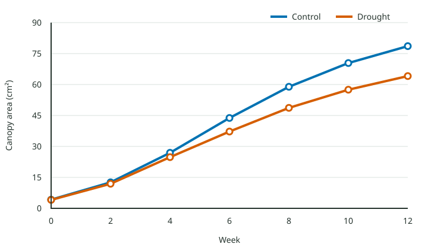
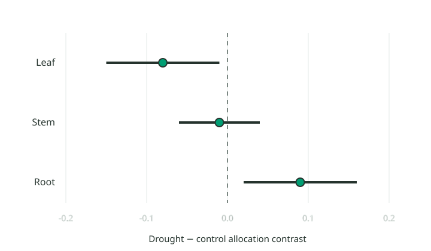
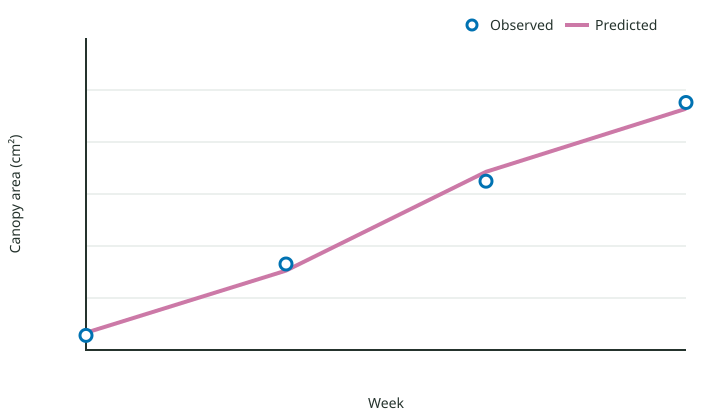

# Cross-language canopy responses to intermittent drought

## Abstract {.unnumbered}

Intermittent drought changed canopy expansion before final biomass diverged. This article-sized fixture keeps its authors, citations, computations, semantic objects, and review history in one portable project.

## Introduction {#sec-introduction}

Reproducible scientific writing should connect claims to inspectable evidence without publishing analysis source by default [@vezy2024; @chen2025]. We therefore compared matching Python, R, and Julia summaries while retaining clean publication outputs.

## Methods {#sec-methods}

We observed 48 plants across six measurements and used the same treatment summaries in three language sessions. Calibration and exclusion rules were fixed before analysis.[^protocol]

[^protocol]: The portable protocol records weekly image calibration, treatment assignment, and exclusion criteria.

## Results {#sec-results}

The retained Python trajectory is shown in @fig-python-canopy, with its numerical summary in @tbl-python-means.

```python {#cell-python-figure .execute output="figure" reference="fig-python-canopy" produces="figures/python-canopy.svg"}
from pathlib import Path
Path("figures").mkdir(exist_ok=True)
Path("figures/python-canopy.svg").write_text("<svg xmlns='http://www.w3.org/2000/svg' viewBox='0 0 10 10'><path d='M0 9L9 1'/></svg>", encoding="utf-8")
```

<!-- dm-output:start cell="cell-python-figure" run="sha256:python-figure" -->
{#fig-python-canopy}
: Python canopy trajectories across the measurement period.
<!-- dm-output:end -->

```python {#cell-python-table .execute output="table" reference="tbl-python-means"}
print("| Treatment | Mean |\n| --- | ---: |\n| Control | 21.8 |\n| Drought | 18.4 |")
```

<!-- dm-output:start cell="cell-python-table" run="sha256:python-table" -->
| Treatment | Mean canopy area |
| :--- | ---: |
| Control | 21.8 |
| Drought | 18.4 |
: Python treatment means. {#tbl-python-means}
<!-- dm-output:end -->

The R interval view in @fig-r-allocation and coefficient table in @tbl-r-coefficients preserve the inferential summary.

```r {#cell-r-figure .execute output="figure" reference="fig-r-allocation" produces="figures/r-allocation.svg"}
dir.create("figures", showWarnings = FALSE)
writeLines("<svg xmlns='http://www.w3.org/2000/svg' viewBox='0 0 10 10'><circle cx='5' cy='5' r='3'/></svg>", "figures/r-allocation.svg")
```

<!-- dm-output:start cell="cell-r-figure" run="sha256:r-figure" -->
{#fig-r-allocation}
: R interval estimates for the allocation contrast.
<!-- dm-output:end -->

```r {#cell-r-table .execute output="table" reference="tbl-r-coefficients"}
cat("| Term | Estimate |\n| --- | ---: |\n| Intercept | 0.71 |\n| Drought | -0.18 |")
```

<!-- dm-output:start cell="cell-r-table" run="sha256:r-table" -->
| Term | Estimate |
| :--- | ---: |
| Intercept | 0.71 |
| Drought | -0.18 |
: R model coefficients. {#tbl-r-coefficients}
<!-- dm-output:end -->

The Julia fit in @fig-julia-model agrees with the grouped predictions in @tbl-julia-predictions.

```julia {#cell-julia-figure .execute output="figure" reference="fig-julia-model" produces="figures/julia-model.svg"}
mkpath("figures")
write("figures/julia-model.svg", "<svg xmlns='http://www.w3.org/2000/svg' viewBox='0 0 10 10'><path d='M0 8Q5 1 10 2'/></svg>")
```

<!-- dm-output:start cell="cell-julia-figure" run="sha256:julia-figure" -->
{#fig-julia-model}
: Julia model fit against the observed canopy response.
<!-- dm-output:end -->

```julia {#cell-julia-table .execute output="table" reference="tbl-julia-predictions"}
println("| Week | Predicted |\n| ---: | ---: |\n| 4 | 18.2 |\n| 8 | 42.7 |")
```

<!-- dm-output:start cell="cell-julia-table" run="sha256:julia-table" -->
| Week | Predicted canopy area |
| ---: | ---: |
| 4 | 18.2 |
| 8 | 42.7 |
: Julia grouped predictions. {#tbl-julia-predictions}
<!-- dm-output:end -->

Published in-text results remain ordinary prose: mean drought canopy area was {{python_mean}}, the R contrast had *p* = {{r_p_value}}, and the Julia fit reached $R^2$ = {{julia_r2}}.

```python {#cell-python-values .execute output="values"}
publish("python_mean", 18.4, unit="cm", digits=1)
```

<!-- dm-output:start cell="cell-python-values" run="sha256:cell-python-values" -->
<!-- dm-published-value data="%7B%22version%22%3A1%2C%22name%22%3A%22python_mean%22%2C%22value%22%3A18.4%2C%22unit%22%3A%22cm%22%2C%22formatting%22%3A%7B%22digits%22%3A1%7D%2C%22rendered%22%3A%22%22%2C%22provenance%22%3A%7B%22cellId%22%3A%22cell-python-values%22%2C%22language%22%3A%22python%22%2C%22runHash%22%3A%22sha256%3Acell-python-values%22%2C%22codeHash%22%3A%22sha256%3Acode-cell-python-values%22%2C%22environmentFingerprint%22%3A%22sha256%3Aalpha-python%22%2C%22sessionGeneration%22%3A1%2C%22executionSequence%22%3A3%2C%22retainedOutputHashes%22%3A%5B%22sha256%3Acell-python-values%22%5D%7D%7D" -->
<!-- dm-output:end -->

```r {#cell-r-values .execute output="values"}
publish("r_p_value", 0.032, digits = 3)
```

<!-- dm-output:start cell="cell-r-values" run="sha256:cell-r-values" -->
<!-- dm-published-value data="%7B%22version%22%3A1%2C%22name%22%3A%22r_p_value%22%2C%22value%22%3A0.032%2C%22formatting%22%3A%7B%22digits%22%3A3%7D%2C%22rendered%22%3A%22%22%2C%22provenance%22%3A%7B%22cellId%22%3A%22cell-r-values%22%2C%22language%22%3A%22r%22%2C%22runHash%22%3A%22sha256%3Acell-r-values%22%2C%22codeHash%22%3A%22sha256%3Acode-cell-r-values%22%2C%22environmentFingerprint%22%3A%22sha256%3Aalpha-r%22%2C%22sessionGeneration%22%3A1%2C%22executionSequence%22%3A3%2C%22retainedOutputHashes%22%3A%5B%22sha256%3Acell-r-values%22%5D%7D%7D" -->
<!-- dm-output:end -->

```julia {#cell-julia-values .execute output="values"}
@publish julia_r2 digits=2
```

<!-- dm-output:start cell="cell-julia-values" run="sha256:cell-julia-values" -->
<!-- dm-published-value data="%7B%22version%22%3A1%2C%22name%22%3A%22julia_r2%22%2C%22value%22%3A0.91%2C%22formatting%22%3A%7B%22digits%22%3A2%7D%2C%22rendered%22%3A%22%22%2C%22provenance%22%3A%7B%22cellId%22%3A%22cell-julia-values%22%2C%22language%22%3A%22julia%22%2C%22runHash%22%3A%22sha256%3Acell-julia-values%22%2C%22codeHash%22%3A%22sha256%3Acode-cell-julia-values%22%2C%22environmentFingerprint%22%3A%22sha256%3Aalpha-julia%22%2C%22sessionGeneration%22%3A1%2C%22executionSequence%22%3A3%2C%22retainedOutputHashes%22%3A%5B%22sha256%3Acell-julia-values%22%5D%7D%7D" -->
<!-- dm-output:end -->

The []{#dm-alpha-suggestion-start .dm-anchor data-anchor="dm-alpha-suggestion-range" data-edge="start"}drought reduced mean canopy expansion[]{#dm-alpha-suggestion-end .dm-anchor data-anchor="dm-alpha-suggestion-range" data-edge="end"}.

Model diagnostics remained within the pre-registered bounds[]{#dm-alpha-comment .dm-anchor data-anchor="dm-alpha-comment" data-edge="point" data-affinity="after"}.

## Discussion {#sec-discussion}

The matching outputs support the same interpretation while leaving each language environment independently reproducible. The cross-language agreement also makes the exported article easier to audit.

## Conclusion {#sec-conclusion}

Friendly semantic objects, retained outputs, and portable review records can coexist without exposing machine identifiers in the publication.

::::: {.draftmatter-reviews .hidden data-schema="1"}
:::: {#dm-alpha-suggestion .dm-change data-anchor="dm-alpha-suggestion-range" data-kind="replace" data-author="dm-alpha-author" data-status="open" data-created="2026-07-18T08:00:00.000Z"}
~~~{.dm-proposal}
drought reduced mean canopy expansion by 18%
~~~
::::
:::: {#dm-alpha-thread .dm-thread data-anchor="dm-alpha-comment" data-author="dm-alpha-reviewer" data-status="open" data-created="2026-07-18T08:05:00.000Z"}
~~~{.dm-message data-author="dm-alpha-reviewer" data-created="2026-07-18T08:05:00.000Z"}
Please retain the diagnostic threshold in the archived protocol.
~~~
::::
:::: {#dm-alpha-author .dm-author data-name="Ada Researcher"}
::::
:::: {#dm-alpha-reviewer .dm-author data-name="Lin Chen"}
::::
:::::
